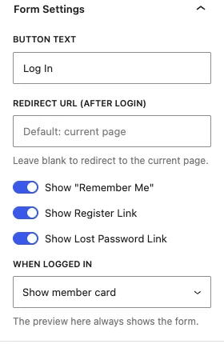
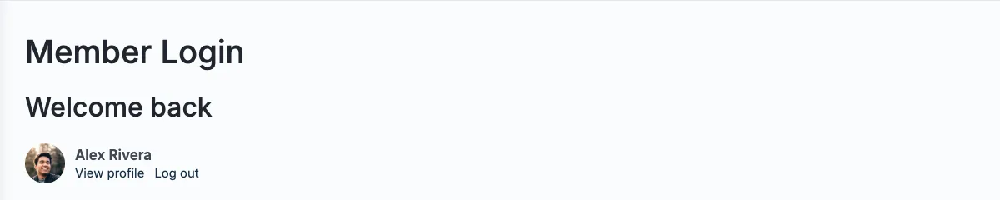

# Content Blocks (FAQ, login form, portfolio, tabs, timeline)

**Also called:** FAQ accordion, questions and answers, login box, sign in form, project grid, filterable gallery, tabbed content, history timeline.

This page covers five blocks that organise information. They are **FAQ Accordion** (questions and answers), **Login Form** (a log in box), **Portfolio Grid** (a filterable project grid), **Tabs** and **Timeline**. They appear in the block inserter under **Essential - Content** and need no other plugin.

Every block here also has the Spacing and Advanced settings described in [Blocks Overview](blocks-overview.md).

## FAQ Accordion

Collapsible questions and answers. It can also output FAQPage structured data so search engines can read your FAQ.

**What it is for:** Use it to answer common questions in a tidy list that opens and closes.

### Add it

1. Open the block inserter.
2. Search for **FAQ Accordion**.
3. Select it to insert it into the page.

### Settings

| Panel | Setting | What it does | Default |
|-------|---------|--------------|---------|
| FAQ Items | Item list | Select an item to edit it, or remove it. | Sample items |
| Edit Selected FAQ | Question | The question text. | Per item |
| Edit Selected FAQ | Answer | The answer text. | Per item |
| Layout | Icon Style | Chevron, Plus or Arrow icon on each question. | Chevron |
| Layout | Allow Multiple Open | Lets more than one item stay open at once. | Off |
| Layout | Open First Item | Opens the first FAQ when the page loads. | On |
| Layout | Enable FAQ Schema (JSON-LD) | Outputs FAQPage structured data for SEO. | On |
| Style | Question Color | Color of the question text. | Theme text |
| Style | Question Background | Background of each question row. | Theme surface |
| Style | Answer Color | Color of the answer text. | Theme muted text |
| Style | Border Color | Color of the item borders. | Theme border |
| Style | Icon Color | Color of the icon. | #667eea |
| Style | Border Radius, Box Shadow | Rounds the block corners and adds a shadow. | Shadow off |

## Login Form

A WordPress login form with your own button text, colors and redirect.

**What it is for:** Use it to put a log in box on any page or in a sidebar.

### Add it

1. Open the block inserter.
2. Search for **Login Form**.
3. Select it to insert it into the page.

### Settings

| Panel | Setting | What it does | Default |
|-------|---------|--------------|---------|
| Form Settings | Button Text | Label of the login button. | Log In |
| Form Settings | Redirect URL (after login) | Where visitors go after logging in. Leave blank to return to the current page. | Blank |
| Form Settings | Show "Remember Me" | Shows the remember-me checkbox. | On |
| Form Settings | Show Register Link | Shows a link to the registration page. | On |
| Form Settings | Show Lost Password Link | Shows a link to the password reset page. | On |
| Form Settings | When logged in | What a logged-in member sees: nothing, a message, or a member card (photo, name, profile and log out links). The editor preview always shows the form. | Show nothing |
| Form Settings | Logged-In Message | Text shown when "When logged in" is set to Show a message. | You are already logged in. |
| Style | Form Background | Background of the form. | Transparent |
| Style | Label Color | Color of the field labels. | Theme text color |
| Style | Button Background | Background of the login button. | Theme button color |
| Style | Button Text Color | Text color of the login button. | Theme button text color |
| Style | Link Color | Color of the register and lost-password links. | Theme link color |
| Style | Border Radius, Box Shadow | Rounds the form corners and adds a shadow. | Shadow off |

### Tips

- Colors left empty follow your theme, in light and dark mode (Reign, BuddyX and BuddyX Pro). Clear a color to go back to the theme color.
- For a sidebar login box, keep "When logged in" on Show nothing: members see the next widget instead.
- Padding defaults to 0. Add padding when you give the form a background.
- The register link appears only when your site allows new users to register (Settings > General > Membership).

## Portfolio Grid

A grid of posts or custom post types with a category filter bar, hover effects and responsive columns.

**What it is for:** Use it to show your work or any posts in a grid that visitors filter by category.

### Add it

1. Open the block inserter.
2. Search for **Portfolio Grid**.
3. Select it to insert it into the page.

### Settings

| Panel | Setting | What it does | Default |
|-------|---------|--------------|---------|
| Query Settings | Post Type | The post type to list. | Post |
| Query Settings | Posts Per Page | How many items to show. | 9 |
| Layout | Columns (Desktop) | Columns on desktop. | 3 |
| Layout | Columns (Tablet) | Columns on tablets. | 2 |
| Layout | Columns (Mobile) | Columns on phones. | 1 |
| Layout | Gap (px) | Space between cards. | 16 |
| Layout | Image Ratio | 1:1 (Square), 4:3, 3:2, 16:9 or 3:4 (Portrait). | 1:1 |
| Card Settings | Show Filter Bar | Shows category tabs above the grid. | On |
| Card Settings | Show Category Badge | Shows the category on each card. | On |
| Card Settings | Show Excerpt | Shows the excerpt on each card. | Off |
| Card Settings | Hover Effect | Overlay, Zoom or Slide Up. | Overlay |
| Card Settings | Card Border Radius (px) | Roundness of each card. | 8 |
| Style | Overlay Color | Color of the hover overlay. | rgba(102, 126, 234, 0.85) |
| Style | Title Color (on hover) | Title color over the overlay. | #ffffff |
| Style | Filter Active Color | Color of the selected filter tab. | #667eea |
| Style | Box Shadow, Border Radius | Adds a shadow and rounds the block corners. | Shadow off |

### Tips

- The filter bar is built from the categories of the items shown.
- The block says "No portfolio items found" if no items match.
## Tabs

Click-to-switch content panels with an underline or boxed style. The tab list works with a keyboard and screen readers.

**What it is for:** Use it to fit several short sections into one space, with one tab open at a time.

### Add it

1. Open the block inserter.
2. Search for **Tabs**.
3. Select it to insert it into the page.

### Settings

| Panel | Setting | What it does | Default |
|-------|---------|--------------|---------|
| Tab Items | Tab list | Select a tab to edit it, or remove it. | Sample tabs |
| Edit Selected Tab | Tab Title | Label on the tab. | Per tab |
| Edit Selected Tab | Tab Content | Content shown when the tab is active. | Per tab |
| Layout | Tab Style | Underline or Boxed. | Underline |
| Layout | Tab Alignment | Left, Center or Right. | Left |
| Style | Active Tab Color | Color of the selected tab. | #667eea |
| Style | Inactive Tab Color | Color of the other tabs. | #6c757d |
| Style | Content Background | Background of the content area. | #ffffff |
| Style | Border Color | Color of the borders. | #e9ecef |
| Style | Border Radius, Box Shadow | Rounds the block corners and adds a shadow. | Shadow off |

## Timeline

A vertical timeline with icon dots, date labels and cards.

**What it is for:** Use it to show a history or a list of steps in date order.

### Add it

1. Open the block inserter.
2. Search for **Timeline**.
3. Select it to insert it into the page.

### Settings

| Panel | Setting | What it does | Default |
|-------|---------|--------------|---------|
| Timeline Items | Item list | Select an item to edit it, or remove it. | Sample items |
| Edit Selected Item | Date / Year | Label shown with the item. | Per item |
| Edit Selected Item | Icon / Emoji | Character shown in the dot. | Per item |
| Edit Selected Item | Title | Item heading. | Per item |
| Edit Selected Item | Description | Item text. | Per item |
| Layout | Timeline Layout | Alternating (left and right), Left (all on right of line) or Right (all on left of line). | Alternating |
| Layout | Dot Size (px) | Size of each dot. | 40 |
| Style | Line Color | Color of the vertical line. | #e9ecef |
| Style | Dot Color | Color of the dots. | #667eea |
| Style | Card Background | Background of each card. | #ffffff |
| Style | Date Color | Color of the date label. | #667eea |
| Style | Title Color | Color of the item title. | #1e1e2e |
| Style | Description Color | Color of the item text. | #6c757d |
| Style | Border Radius, Box Shadow | Rounds the block corners and adds a shadow. | Shadow off |

## You'll know it worked when

View the page. Questions open and close, tabs switch when clicked, the portfolio filter hides other categories, and the login form shows your button text.

## Good to know

### Does the FAQ help with Google search?

Yes. **Enable FAQ Schema (JSON-LD)** is on by default and tells search engines about your questions.

### What does a logged-in member see in the Login Form?

Whatever you choose in **When logged in**: nothing, a message or a member card.

## For developers

Each block has an internal name, used in block markup and code.

| Block | Internal name |
|-------|---------------|
| FAQ Accordion | `wbcom-essential/faq-accordion` |
| Login Form | `wbcom-essential/login-form` |
| Portfolio Grid | `wbcom-essential/portfolio-grid` |
| Tabs | `wbcom-essential/tabs` |
| Timeline | `wbcom-essential/timeline` |
