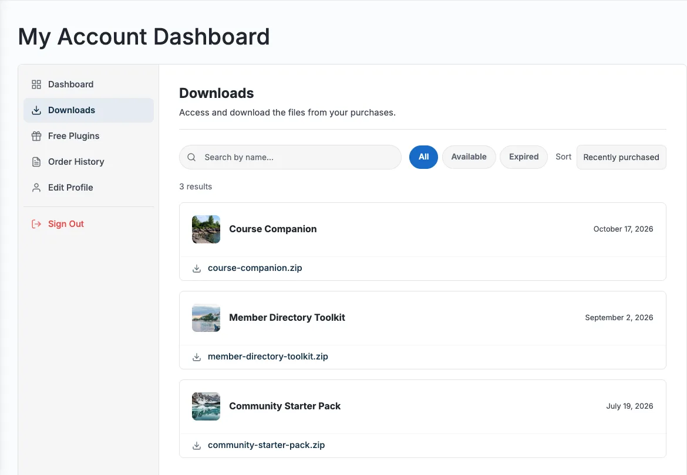
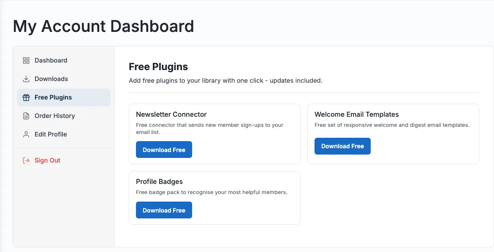
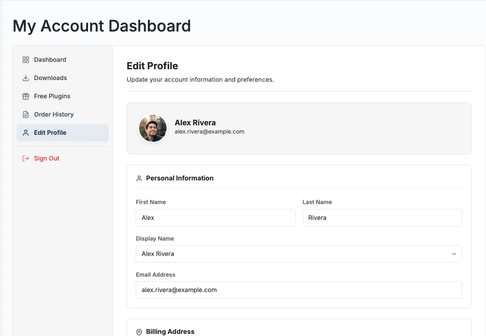
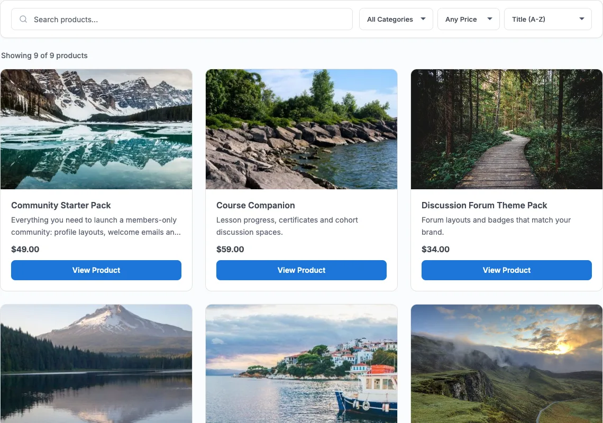
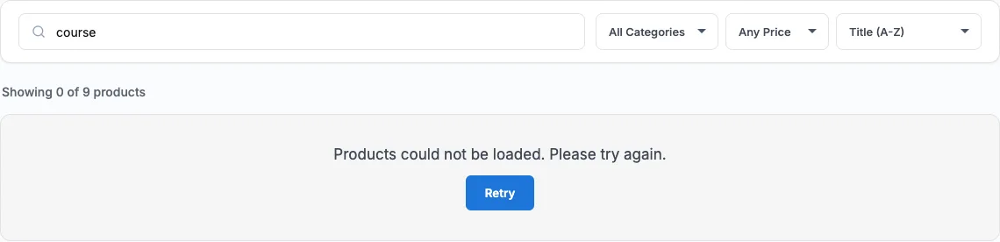

# EDD Blocks (Account page, checkout extras, product catalog)

**Also called:** customer account page, my account, downloads page, licence page, checkout extras, trust badges, thank you page, order confirmation, download store, product catalog.

This page covers eight blocks for an Easy Digital Downloads store.

- **EDD Account Dashboard**: the customer account page.
- **EDD Checkout Progress**, **Recommendations**, **Social Proof** and **Trust Badges**: extras for the checkout page.
- **EDD Order Success**: the thank you page.
- **Product Catalog**: a download store page.
- **EDD Enhanced Checkout**: an old block kept for saved pages.

They appear in the block inserter under **Essential - EDD**. They need Easy Digital Downloads.

If Easy Digital Downloads is not active, these blocks show a notice that says "Easy Digital Downloads is required for this block".

Four blocks are checkout extras: Checkout Progress, Recommendations, Social Proof and Trust Badges. They sit inside the EDD Checkout block. They have only padding and device visibility, with no margin or shadow. The other blocks have the shared Spacing and Advanced settings described in [Blocks Overview](blocks-overview.md).

## EDD Account Dashboard

One My Account page for customers, with a sidebar menu, downloads, order history and optional license and subscription tabs.

**What it is for:** Use it to give customers one page for their downloads, orders, licences and profile.

### Add it

1. Create a page for the customer account.
2. Open the block inserter and search for **EDD Account Dashboard**.
3. Select it to insert it into the page.

### Settings

| Panel | Setting | What it does | Default |
|-------|---------|--------------|---------|
| Settings | Default Tab | The tab shown when the page first loads: Dashboard, Downloads, Order History, Free Plugins or Edit Profile. | Dashboard |
| Settings | Show Support Link | Adds a support link to the sidebar. | On |
| Settings | Support URL | Full URL of your support portal or helpdesk. Shown when Show Support Link is on. | The Wbcom Designs support page |
| Settings | Support Link Label | Text of the support link. Shown when Show Support Link is on. | Submit Ticket |
| Settings | Show special offers banner | Shows the offers banner. | On |
| Settings | Show What's New | Shows the What's New section. | On |
| Settings | Show recommendations | Shows product recommendations. | On |
| Advanced | Padding, Margin, Box Shadow, Border Radius | Spacing, shadow and corners of the block. | Shadow off |
| Advanced | Device Visibility | Hide on Desktop, Tablet or Mobile. | All shown |

### What customers see in each tab

| Tab | What it shows |
|-----|---------------|
| Dashboard | A greeting, recent orders with invoice links, and the optional special offers banner, What's New and recommendations. |
| Subscriptions | Needs EDD Recurring Payments. Each subscription shows its next renewal. Customers can upgrade, cancel (with an optional reason), reactivate and renew. After cancelling, access continues to the end of the billing period. The reason and comment are saved as a note on the subscription and emailed to the site admin address. |
| Downloads | Every product the customer owns, 12 per page, with a search by product name, an All / Available / Expired filter and a sort by Recently purchased or Name (A-Z). A product whose licence has expired shows "License expired. Renew to download your files again." with a **Renew License** button, instead of a download link. |
| Free Plugins | Your free downloads, each with a one-click claim. A claim creates a free order and the customer can download straight away. Each customer can make 10 new claims per hour. |
| Licenses | Needs EDD Software Licensing. License keys, 10 per page, with a search by product name, an All / Active / Expired filter and a sort by Recently added, Expiry date or Status. Each licence shows its key, expiry (or Lifetime), the sites it is active on with a **Deactivate** link, and **Upgrade License** and **Renew License** buttons. |
| Order History | Past orders with their status and an invoice link. |
| Edit Profile | Name, display name, email address, billing address and a password change. Leaving the password fields blank keeps the current password. |

Order, sale, subscription and licence dates show in your site's timezone (**Settings > General > Timezone**).

Search, filter and sort update the list without reloading the page. If a search finds nothing, customers see "No items match your search or filter. Try clearing them."

### Tips

- Change the Support URL to your own helpdesk. The default points to the Wbcom Designs support page.
- Logged-out visitors see a login form that returns them to the same page. It has [login protection](../features/login-security.md) built in.
- A Subscriptions tab appears when EDD Recurring Payments is active. A Licenses tab appears when EDD Software Licensing is active.

## EDD Enhanced Checkout (legacy)

A legacy wrapper kept only so pages saved before version 4.7.0 keep working. It no longer appears in the block inserter.

**What it is for:** Use it only to keep old pages working. Do not add it to new pages.

For new pages, use the EDD Checkout block. Add the checkout extras inside it: [EDD Checkout Progress](#edd-checkout-progress), [Recommendations](#edd-checkout-recommendations), [Social Proof](#edd-checkout-social-proof) and [Trust Badges](#edd-checkout-trust-badges).

## EDD Checkout Progress

A four-step progress indicator: Cart, Details, Payment and Complete.

**What it is for:** Use it to show customers where they are in the buying steps.

### Add it

1. Open the page that holds the EDD Checkout block.
2. Open the block inserter and search for **EDD Checkout Progress**.
3. Select it to insert it into the checkout.

### Settings

| Panel | Setting | What it does | Default |
|-------|---------|--------------|---------|
| Progress Options | None | This section has no options yet. | - |
| Spacing | Padding | Space inside the block. | Block default |
| Spacing | Device Visibility | Hide on Desktop, Tablet or Mobile. | All shown |

### Tips

- The steps are a visual guide. EDD's block checkout shows cart, details and payment on one page.

## EDD Checkout Recommendations

A "Customers Also Purchased" list of products based on what is in the cart.

**What it is for:** Use it to suggest more products while a customer checks out.

### Add it

1. Open the page that holds the EDD Checkout block.
2. Open the block inserter and search for **EDD Checkout Recommendations**.
3. Select it to insert it into the checkout.

### Settings

| Panel | Setting | What it does | Default |
|-------|---------|--------------|---------|
| Recommendation Options | Number of Recommendations | How many products to suggest, 1 to 6. | 3 |
| Spacing | Padding | Space inside the block. | Block default |
| Spacing | Device Visibility | Hide on Desktop, Tablet or Mobile. | All shown |

### Tips

- The block needs the **EDD Recommended Products** add-on. Without it, or with an empty cart, or when the cart has no suggestions, visitors see nothing; administrators see a note that names the add-on.

## EDD Checkout Social Proof

Customer reviews and a Trustpilot rating with your own review cards. It works on checkout, product and landing pages.

**What it is for:** Use it to build trust with reviews and your Trustpilot score.

### Add it

1. Open the page where you want social proof.
2. Open the block inserter and search for **EDD Checkout Social Proof**.
3. Select it to insert it into the page.

### Settings

| Panel | Setting | What it does | Default |
|-------|---------|--------------|---------|
| Social Proof Options | Show Customer Reviews | Shows reviews from your store. | On |
| Social Proof Options | Number of Reviews | How many reviews to show, 1 to 6. Shown when Show Customer Reviews is on. | 3 |
| Social Proof Options | Show Trustpilot Section | Shows the Trustpilot section. | On |
| Social Proof Options | Trustpilot Rating | Your real Trustpilot score, 0 to 5. At 0 the score is not shown. | 0 |
| Social Proof Options | Total Reviews | Total number of your Trustpilot reviews. | 0 |
| Social Proof Options | Trustpilot URL | Link to your Trustpilot page. | Blank |
| Social Proof Options | Review Cards | Your own reviews: Reviewer Name, Stars, Title and Review Text. Add up to 5 with + Add Review. | None |
| Spacing | Padding | Space inside the block. | Block default |
| Spacing | Device Visibility | Hide on Desktop, Tablet or Mobile. | All shown |

### Tips

- Customer reviews come from the EDD Reviews extension.
- The Trustpilot section stays hidden until you add at least one review card.
- With no review cards and no approved reviews, visitors see nothing; administrators see a note that says how to add reviews.

## EDD Checkout Trust Badges

Security, money-back guarantee and support badges, plus icons for the payment methods you accept.

**What it is for:** Use it to reassure customers about security, refunds and support.

### Add it

1. Open the page that holds the EDD Checkout block.
2. Open the block inserter and search for **EDD Checkout Trust Badges**.
3. Select it to insert it into the checkout.

### Settings

| Panel | Setting | What it does | Default |
|-------|---------|--------------|---------|
| Security Badge | Show security badge | Shows the security badge. | On |
| Security Badge | Trust Badge Text | Badge heading. Name your own payment processor if you mention one. | Secure checkout |
| Security Badge | Security Description | Badge text. Word it so it stays true for your store. | Your payment information is encrypted and secure. |
| Guarantee Badge | Show guarantee badge | Shows the guarantee badge. | On |
| Guarantee Badge | Money-Back Guarantee (days) | Length of the guarantee, 7 to 90 days. | 30 |
| Guarantee Badge | Guarantee Description | Badge text. Match it to your refund policy. | Covered by our money-back guarantee. |
| Support Badge | Show support badge | Shows the support badge. | Off |
| Support Badge | Support Title | Badge heading. | Priority Support |
| Support Badge | Support Description | Badge text. Describe the support you provide. | Dedicated support for all customers. |
| Payment Icons | Visa, Mastercard, Paypal, Stripe, Razorpay | Tick the payment methods your store accepts. | All off |
| Spacing | Padding | Space inside the block. | Block default |
| Spacing | Device Visibility | Hide on Desktop, Tablet or Mobile. | All shown |

### Tips

- The badges make claims to your customers. Turn on only the ones that are true for your store.

## EDD Order Success

A purchase confirmation page with a success header, the order receipt and next-step cards.

**What it is for:** Use it for the thank you page a customer sees after paying.

### Add it

1. Open the page you set as the EDD Success page.
2. Open the block inserter and search for **EDD Order Success**.
3. Select it to insert it into the page.

### Settings

| Panel | Setting | What it does | Default |
|-------|---------|--------------|---------|
| Success Header | Show Success Header | Shows the header with the confirmation message. | On |
| Success Header | Success Message | The main heading shown after purchase. | Thank you for your purchase! |
| What's Next Section | Show What's Next Cards | Shows cards for downloads, licenses and the account. | On |
| What's Next Section | Account Page URL | URL of your purchase history or account page. Leave blank to use the EDD default. | Blank |
| Advanced | Padding, Margin, Box Shadow, Border Radius | Spacing, shadow and corners of the block. | Shadow off |
| Advanced | Device Visibility | Hide on Desktop, Tablet or Mobile. | All shown |

### Tips

- The receipt is the standard EDD receipt.
- The header follows the order. A completed order shows the success message. A pending or processing order shows "We've received your order" and says the payment is being confirmed. A failed or cancelled order shows "This order was not completed". A visitor who cannot view the receipt gets EDD's own message.
- The What's Next cards link to downloads and the account page. A license card appears when EDD Software Licensing is active.

## Product Catalog

A product grid for your EDD downloads with search, category, price and sort filters. Filtering updates the grid without reloading the page.

**What it is for:** Use it for a download store page that visitors can search and filter.

### Add it

1. Open the block inserter.
2. Search for **Product Catalog**.
3. Select it to insert it into the page.

### Settings

| Panel | Setting | What it does | Default |
|-------|---------|--------------|---------|
| Layout | Columns | Number of columns. | 3 |
| Layout | Products per page | How many products load at a time. | 12 |
| Category | Show products from | All Categories or one download category. | All Categories |
| Filters | Search bar | Shows the search field. | On |
| Filters | Category filter | Shows the category filter. | On |
| Filters | Price filter | Shows the price filter. | On |
| Filters | Sort dropdown | Shows the sort menu. | On |
| Filters | Default sort | Title (A-Z), Newest first, Price: Low to High, Price: High to Low or Most Popular. | Title (A-Z) |
| Advanced | Padding, Margin, Box Shadow, Border Radius | Spacing, shadow and corners of the block. | Shadow off |
| Advanced | Device Visibility | Hide on Desktop, Tablet or Mobile. | All shown |

### Tips

- A Load More button loads the next products.
- The block says "No products found matching your filters" if no product matches the filters.
- If loading fails, the block shows a Retry button.

## You'll know it worked when

View the page while Easy Digital Downloads is active. You see your account tabs, checkout extras, thank you page or product grid.

## Good to know

### Why is EDD Enhanced Checkout missing from the inserter?

It is kept only for pages saved before version 4.7.0. Use the EDD Checkout block with the checkout extras instead.

### Where do the checkout extras go?

Inside the EDD Checkout block, on your checkout page.

## For developers

Each block has an internal name, used in block markup and code.

| Block | Internal name |
|-------|---------------|
| EDD Account Dashboard | `wbcom-essential/edd-account-dashboard` |
| EDD Enhanced Checkout (legacy) | `wbcom-essential/edd-checkout-enhanced` |
| EDD Checkout Progress | `wbcom-essential/edd-checkout-progress` |
| EDD Checkout Recommendations | `wbcom-essential/edd-checkout-recommendations` |
| EDD Checkout Social Proof | `wbcom-essential/edd-checkout-social` |
| EDD Checkout Trust Badges | `wbcom-essential/edd-checkout-trust` |
| EDD Order Success | `wbcom-essential/edd-order-success` |
| Product Catalog | `wbcom-essential/product-catalog` |
