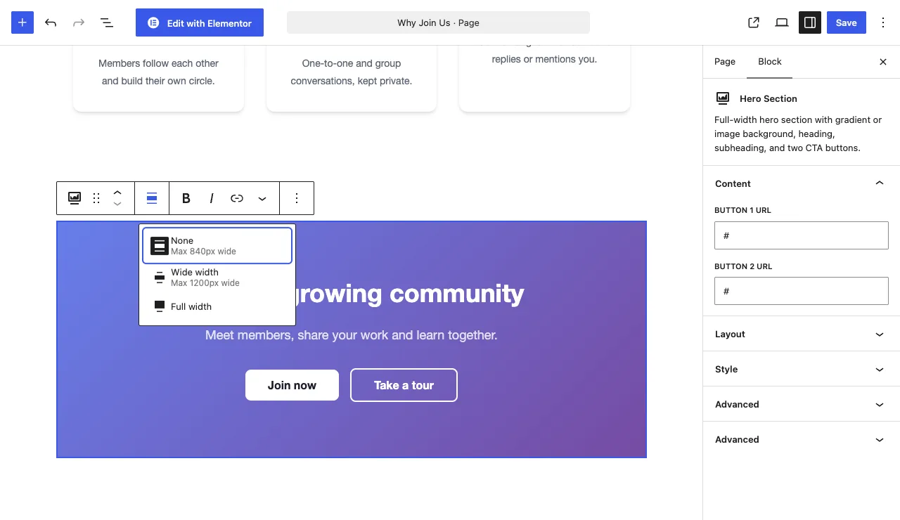
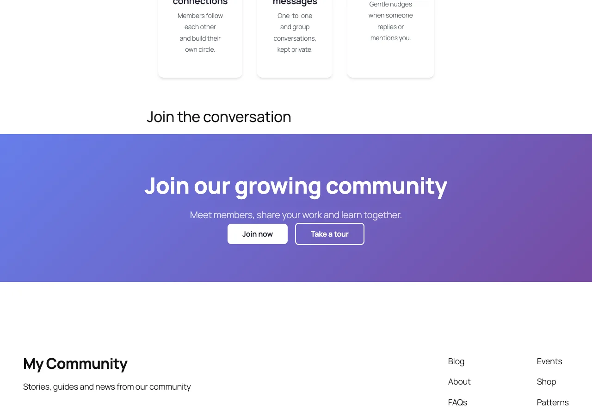

# Marketing Blocks (Hero banner, pricing table, testimonials, countdown)

**Also called:** hero banner, landing page header, pricing table, plan comparison, testimonial slider, reviews slider, countdown timer, call to action, promo banner, feature list.

This page covers seven blocks that help you promote and sell. They are **Countdown Timer**, **CTA Section** (a call to action), **Feature Grid** and **Hero Section** (a hero banner). The rest are **Pricing Table**, **Promo Banner** and **Testimonial Carousel** (a testimonial slider). They appear in the block inserter under **Essential - Marketing** and need no other plugin.

Every block here also has the Spacing and Advanced settings described in [Blocks Overview](blocks-overview.md).

## Countdown Timer

A live countdown to a date and time, with a message shown when time runs out.

**What it is for:** Use it to count down to a sale, launch or event.

### Add it

1. Open the block inserter.
2. Search for **Countdown Timer**.
3. Select it to insert it into the page.

### Settings

| Panel | Setting | What it does | Default |
|-------|---------|--------------|---------|
| Countdown Settings | Target Date & Time | The moment the countdown ends. | Blank |
| Countdown Settings | Expiry Message | Shown when the countdown reaches zero. | This offer has expired! |
| Layout | Display Layout | Boxes, Inline or Minimal. | Boxes |
| Layout | Separator Style | Colon, Dot or None between units. | Colon |
| Layout | Show Days | Shows the days unit. | On |
| Layout | Show Hours | Shows the hours unit. | On |
| Layout | Show Minutes | Shows the minutes unit. | On |
| Layout | Show Seconds | Shows the seconds unit. | On |
| Style | Number Color | Color of the numbers. | Theme text |
| Style | Label Color | Color of the unit labels. | Theme muted text |
| Style | Box Background | Background of each box. | Theme surface |
| Style | Box Border Color | Border of each box. | Theme border |
| Style | Border Radius, Box Shadow | Rounds the corners and adds a shadow. | Shadow off |

## CTA Section

A call-to-action section with a heading, a description and one button.

**What it is for:** Use it to push visitors to one action, such as signing up or buying.

### Add it

1. Open the block inserter.
2. Search for **CTA Section**.
3. Select it to insert it into the page.
4. Click the heading, description and button text on the page to edit them.

### Settings

| Panel | Setting | What it does | Default |
|-------|---------|--------------|---------|
| Content | Button URL | Where the button links. | # |
| Layout | Layout Style | Stacked (Vertical) or Inline (Side by Side). | Stacked |
| Layout | Content Alignment | Left, Center or Right. | Center |
| Style | Background Color | Section background. | Theme surface |
| Style | Heading Color | Color of the heading. | Theme text |
| Style | Description Color | Color of the description. | Theme muted text |
| Style | Button Background | Button background. | #667eea |
| Style | Button Text Color | Button text. | #ffffff |
| Style | Button Hover Background | Button background on hover. | #5a6fd6 |

### Tips

- Set the alignment to Full width in the block toolbar. The section then fills the screen edge to edge, even when your theme limits page width. Wide width is also available. On Reign, choose the Full Width or Stretched page layout, because a boxed layout keeps the section inside the content width.

## Feature Grid

Feature cards in a responsive grid, each with an icon or emoji, a title and a description.

**What it is for:** Use it to list what your product or service offers, with an icon for each point.

### Add it

1. Open the block inserter.
2. Search for **Feature Grid**.
3. Select it to insert it into the page.

### Settings

| Panel | Setting | What it does | Default |
|-------|---------|--------------|---------|
| Content | Icon / Emoji | Character shown on a feature card. | Per feature |
| Content | Title | Feature heading. | Per feature |
| Content | Description | Feature text. | Per feature |
| Layout | Columns | Number of columns, 1 to 4. | 3 |
| Layout | Card Style | Elevated (Shadow), Bordered or Flat. | Elevated |
| Style | Icon Size (px) | Size of the icon, 24 to 96. | 48 |
| Style | Card Background | Card background. | Theme surface |
| Style | Title Color | Color of the titles. | Theme text |
| Style | Description Color | Color of the descriptions. | Theme muted text |

### Tips

- Set the alignment to Full width in the block toolbar. The section then fills the screen edge to edge, even when your theme limits page width. Wide width is also available. On Reign, choose the Full Width or Stretched page layout, because a boxed layout keeps the section inside the content width.
- At tablet width the last row never leaves one card on its own.

## Hero Section

A full-width hero with a gradient, solid color or image background, a heading, a subheading and two buttons.

**What it is for:** Use it for the big banner at the top of a landing page.

### Add it

1. Open the block inserter.
2. Search for **Hero Section**.
3. Select it to insert it into the page.
4. Click the heading, subheading and button text on the page to edit them.

### Settings

| Panel | Setting | What it does | Default |
|-------|---------|--------------|---------|
| Content | Button 1 URL | Where the first button links. | # |
| Content | Button 2 URL | Where the second button links. | # |
| Layout | Content Alignment | Left, Center or Right. | Center |
| Layout | Min Height | Minimum height of the hero. | 500 |
| Layout | Height Unit | Unit for Min Height. | px |
| Style | Background Type | Gradient, Solid Color or Image. | Gradient |
| Style | Gradient Start Color | Start of the gradient. | #667eea |
| Style | Gradient End Color | End of the gradient. | #764ba2 |
| Style | Background Color | Background for the Solid Color type. | #1e1e2e |
| Style | Background Image | Image for the Image type. | None |
| Style | Overlay Color | Color laid over the image. | rgba(0,0,0,0.5) |
| Style | Overlay Opacity (%) | Strength of the overlay. | 50 |
| Style | Heading Color | Color of the heading. | #ffffff |
| Style | Subheading Color | Color of the subheading. | rgba(255,255,255,0.8) |
| Style | Button 1 Background | First button background. | #ffffff |
| Style | Button 1 Text Color | First button text. | #1e1e2e |
| Style | Button 2 Background | Second button background. | transparent |
| Style | Button 2 Text Color | Second button text. | #ffffff |

### Tips

- Set the alignment to Full width in the block toolbar. The section then fills the screen edge to edge, even when your theme limits page width. Wide width is also available. On Reign, choose the Full Width or Stretched page layout, because a boxed layout keeps the section inside the content width.

## Pricing Table

A pricing comparison with one to four plans, a highlighted featured plan and a button for each plan.

**What it is for:** Use it to compare your plans side by side.

### Add it

1. Open the block inserter.
2. Search for **Pricing Table**.
3. Select it to insert it into the page.

### Settings

| Panel | Setting | What it does | Default |
|-------|---------|--------------|---------|
| Content | Currency Symbol | Symbol shown before every price. | $ |
| Content | Plan Name | Name of a plan. | Per plan |
| Content | Price | Price of a plan. | Per plan |
| Content | Period (e.g. /mo) | Billing period shown after the price. | Per plan |
| Content | Button Text | Label of the plan button. | Per plan |
| Content | Button URL | Where the plan button links. | Per plan |
| Content | Featured Plan | Highlights the plan. | Per plan |
| Content | Features | The list of features for a plan. Each can be removed. | Per plan |
| Layout | Columns | Number of columns, 1 to 4. | 3 |
| Style | Card Background | Background of plan cards. | #ffffff |
| Style | Featured Card Background | Background of the featured plan. | #667eea |
| Style | Featured Card Text Color | Text on the featured plan. | #ffffff |
| Style | Price Color | Color of the price. | #1e1e2e |
| Style | Feature Text Color | Color of the feature list. | #6c757d |
| Style | Button Background | Button background. | #667eea |
| Style | Button Text Color | Button text. | #ffffff |

## Promo Banner

A promotional banner with an image, a heading, a description and a button.

**What it is for:** Use it to advertise a sale or an offer with an image and a button.

### Add it

1. Open the block inserter.
2. Search for **Promo Banner**.
3. Select it to insert it into the page.
4. Click the heading, description and button text on the page to edit them.

### Settings

| Panel | Setting | What it does | Default |
|-------|---------|--------------|---------|
| Layout | Banner Style | Overlay (text over image) or Split (image left, text right). | Overlay |
| Layout | Content Alignment | Left, Center or Right. | Center |
| Layout | Min Height (px) | Minimum height of the banner. | 300 |
| Content | Button URL | Where the button links. | # |
| Style | Background Image | The banner image. | None |
| Style | Overlay Color | Color laid over the image. | rgba(0,0,0,0.4) |
| Style | Heading Color | Color of the heading. | #ffffff |
| Style | Description Color | Color of the description. | rgba(255,255,255,0.9) |
| Style | Button Background | Button background. | #ffffff |
| Style | Button Text Color | Button text. | #1e1e2e |

## Testimonial Carousel

Customer quotes in a carousel with dots, arrows and autoplay.

**What it is for:** Use it to show customer quotes in a slider.

### Add it

1. Open the block inserter.
2. Search for **Testimonial Carousel**.
3. Select it to insert it into the page.

### Settings

| Panel | Setting | What it does | Default |
|-------|---------|--------------|---------|
| Testimonials | Testimonial list | Select a testimonial to edit it, or remove it. | Sample testimonials |
| Edit Selected Testimonial | Quote | The testimonial text. | Per testimonial |
| Edit Selected Testimonial | Name | Name of the customer. | Per testimonial |
| Edit Selected Testimonial | Role / Company | Job title or company. | Per testimonial |
| Edit Selected Testimonial | Avatar URL | Optional link to an avatar image. | Blank |
| Layout | Slides Per View (desktop) | Testimonials visible at once. | 1 |
| Layout | Autoplay | Moves slides automatically. | On |
| Layout | Autoplay Delay (ms) | Time between slides. | 5000 |
| Layout | Show Navigation Dots | Shows the dots. | On |
| Layout | Show Prev/Next Arrows | Shows the arrows. | On |
| Layout | Loop Infinitely | Returns to the first slide after the last. | On |
| Style | Card Background | Card background. | Theme surface |
| Style | Quote Text Color | Color of the quote. | Theme text |
| Style | Name Color | Color of the name. | Theme text |
| Style | Role Color | Color of the role. | Theme muted text |
| Style | Accent Color (dots, decorations) | Color of the dots and decorations. | Theme accent |
| Style | Border Radius, Box Shadow | Rounds the card corners and adds a shadow. | Shadow off |

## You'll know it worked when

View the page. Each section shows your own text and colours, the countdown ticks every second, and the testimonial slider moves on its own.

## Good to know

### How do I make a section fill the screen?

Set the alignment to Full width in the block toolbar. See the tip under Hero Section.

### Where do I change the heading text?

Click the text on the page and type. The sidebar holds links, colours and layout.

## For developers

Each block has an internal name, used in block markup and code.

| Block | Internal name |
|-------|---------------|
| Countdown Timer | `wbcom-essential/countdown-timer` |
| CTA Section | `wbcom-essential/cta` |
| Feature Grid | `wbcom-essential/feature-grid` |
| Hero Section | `wbcom-essential/hero` |
| Pricing Table | `wbcom-essential/pricing-table` |
| Promo Banner | `wbcom-essential/promo-banner` |
| Testimonial Carousel | `wbcom-essential/testimonial-carousel` |
