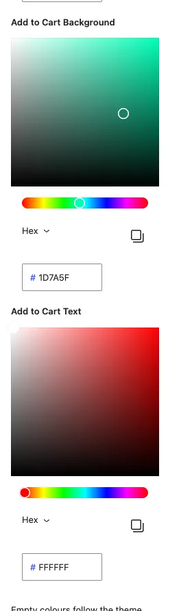
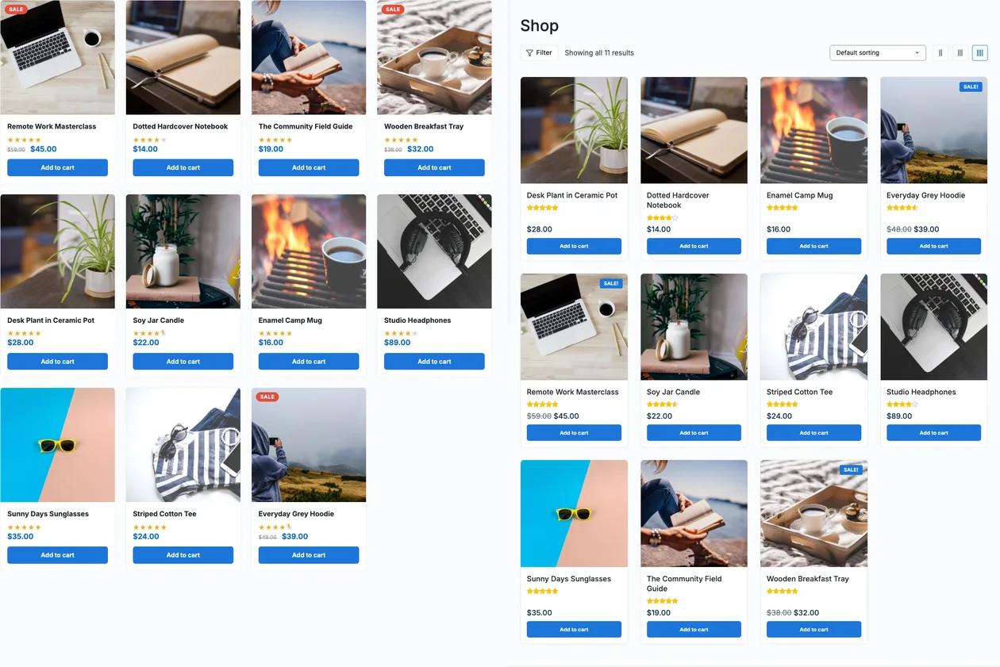

# WooCommerce Blocks (Product slider, product grid, reviews)

**Also called:** product slider, product carousel, product grid, shop grid, featured products, best sellers, store reviews, customer reviews slider.

This page covers three blocks that show your shop: **Customer Reviews** (a review slider), **Product Carousel** (a product slider) and **Product Grid**. They appear in the block inserter under **Essential - WooCommerce**. They need WooCommerce.

If WooCommerce is not active, these blocks show a notice that says "WooCommerce plugin is required for this block".

Every block here also has the Spacing and Advanced settings described in [Blocks Overview](blocks-overview.md).

## Customer Reviews

WooCommerce product reviews in a Swiper carousel, with the reviewer's avatar, star rating, name and a link to the product.

**What it is for:** Use it to show store reviews in a slider as proof that people buy from you.

### Add it

1. Open the block inserter.
2. Search for **Customer Reviews**.
3. Select it to insert it into the page.

### Settings

| Panel | Setting | What it does | Default |
|-------|---------|--------------|---------|
| Query Settings | Number of Reviews | How many reviews to load. | 6 |
| Carousel Settings | Slides Per View (Desktop) | Reviews visible on desktop. | 2 |
| Carousel Settings | Autoplay | Moves slides automatically. | On |
| Carousel Settings | Autoplay Delay (ms) | Time between slides. | 4000 |
| Carousel Settings | Loop | Returns to the first slide after the last. | On |
| Carousel Settings | Show Navigation Dots | Shows the dots. | On |
| Carousel Settings | Show Navigation Arrows | Shows the arrows. | On |
| Review Card Settings | Show Avatar | Shows the reviewer avatar. | On |
| Review Card Settings | Show Star Rating | Shows the star rating. | On |
| Review Card Settings | Show Product Name | Shows the reviewed product with a link. | On |
| Style | Card Background | Card background. | Theme surface |
| Style | Quote Text Color | Color of the review text. | Theme text |
| Style | Reviewer Name Color | Color of the reviewer name. | Theme text |
| Style | Star Rating Color | Color of the filled stars. | #f5a623 |
| Style | Border Radius, Box Shadow | Rounds the card corners and adds a shadow. | Shadow off |

### Tips

- The block says "No reviews found" if your store has no reviews yet.
- The arrows sit beside the cards, not over the review text.
- On right-to-left sites the previous arrow is on the right and the next arrow on the left.
- Cards in the same row share one height. A short review never sits next to a taller card.
- Colors left empty follow your theme in light and dark mode. Pick a color to override it.

## Product Carousel

WooCommerce products in a Swiper carousel with autoplay, arrows, dots and a number of slides that adapts to the screen.

**What it is for:** Use it to show products in a slider, such as new arrivals or best sellers.

### Add it

1. Open the block inserter.
2. Search for **Product Carousel**.
3. Select it to insert it into the page.

### Settings

| Panel | Setting | What it does | Default |
|-------|---------|--------------|---------|
| Query Settings | Products Per Page | How many products to load. | 8 |
| Query Settings | Order By | Date, Title, Price, Popularity, Rating or Random. | Date |
| Query Settings | Order | Descending or Ascending. | Descending |
| Carousel Settings | Slides Per View (Desktop) | Products visible on desktop. | 4 |
| Carousel Settings | Slides Per View (Tablet) | Products visible on tablets. | 2 |
| Carousel Settings | Slides Per View (Mobile) | Products visible on phones. | 1 |
| Carousel Settings | Space Between Slides (px) | Space between cards. | 24 |
| Carousel Settings | Autoplay | Moves slides automatically. | On |
| Carousel Settings | Autoplay Delay (ms) | Time between slides. | 3000 |
| Carousel Settings | Loop | Returns to the first slide after the last. | On |
| Carousel Settings | Show Navigation Dots | Shows the dots. | On |
| Carousel Settings | Show Navigation Arrows | Shows the arrows. | On |
| Card Settings | Show Product Image | Shows the product image. | On |
| Card Settings | Show Price | Shows the price. | On |
| Card Settings | Show Star Rating | Shows the average rating. | On |
| Card Settings | Show Add to Cart | Shows the add-to-cart button. | On |
| Style | Card Background | Card background. | Theme surface |
| Style | Title Color | Color of the product title. | Theme text |
| Style | Price Color | Color of the price. | Theme accent |
| Style | Add to Cart Background | Background of the add-to-cart button. | Theme button color |
| Style | Add to Cart Text | Text of the add-to-cart button. | Theme button text color |
| Style | Border Radius, Box Shadow | Rounds the card corners and adds a shadow. | Shadow off |

### Tips

- The block says "No products found" if no product matches.
- Hidden products are left out. That means products with catalog visibility set to Hidden or Search results only.
- Sold-out products are left out when WooCommerce is set to hide them. Check **WooCommerce > Settings > Products > Inventory > Out of stock visibility**.
- The block shows what your shop pages show.
- Colors left empty follow your theme in light and dark mode. Pick a color to override it.

## Product Grid

WooCommerce products in a responsive grid with a sale badge, star rating and add-to-cart button.

**What it is for:** Use it to list products in a grid on any page, outside your main shop page.

### Add it

1. Open the block inserter.
2. Search for **Product Grid**.
3. Select it to insert it into the page.

### Settings

| Panel | Setting | What it does | Default |
|-------|---------|--------------|---------|
| Query Settings | Products Per Page | How many products to show. | 8 |
| Query Settings | Order By | Date, Title, Price, Popularity, Rating, Random or Menu Order. | Date |
| Query Settings | Order | Descending or Ascending. | Descending |
| Layout | Columns (Desktop) | Columns on desktop. | 4 |
| Layout | Columns (Tablet) | Columns on tablets. | 2 |
| Layout | Columns (Mobile) | Columns on phones. | 1 |
| Layout | Gap (px) | Space between cards. | 24 |
| Layout | Image Ratio | 1:1 (Square), 4:3, 3:4 (Portrait) or 16:9. | 1:1 |
| Card Settings | Show Product Image | Shows the product image. | On |
| Card Settings | Show Price | Shows the price. | On |
| Card Settings | Show Star Rating | Shows the average rating. | On |
| Card Settings | Show Add to Cart | Shows the add-to-cart button. | On |
| Card Settings | Show Sale Badge | Shows a badge on products on sale. | On |
| Style | Card Background | Card background. | Theme surface |
| Style | Title Color | Color of the product title. | Theme text |
| Style | Price Color | Color of the price. | Theme accent |
| Style | Add to Cart Background | Background of the add-to-cart button. | Theme button color |
| Style | Add to Cart Text | Text of the add-to-cart button. | Theme button text color |
| Style | Sale Badge Color | Color of the sale badge. | #e74c3c |
| Style | Border Radius, Box Shadow | Rounds the card corners and adds a shadow. | Shadow off |

### Tips

- The block says "No products found" if no product matches.
- Hidden products are left out. That means products with catalog visibility set to Hidden or Search results only.
- Sold-out products are left out when WooCommerce is set to hide them. Check **WooCommerce > Settings > Products > Inventory > Out of stock visibility**.
- The block shows what your shop pages show.
- Colors left empty follow your theme in light and dark mode. Pick a color to override it.

## You'll know it worked when

View the page while WooCommerce is active. You see your real products or reviews with prices and buttons.

## Good to know

### Why is a product missing from the block?

Hidden products are left out. So are sold-out products if WooCommerce hides them. The block follows your shop page.

### Can I match my theme colours?

Yes. Leave a colour empty and it follows your theme, in light and dark mode.

## For developers

Each block has an internal name, used in block markup and code.

| Block | Internal name |
|-------|---------------|
| Customer Reviews | `wbcom-essential/customer-reviews` |
| Product Carousel | `wbcom-essential/product-carousel` |
| Product Grid | `wbcom-essential/product-grid` |
