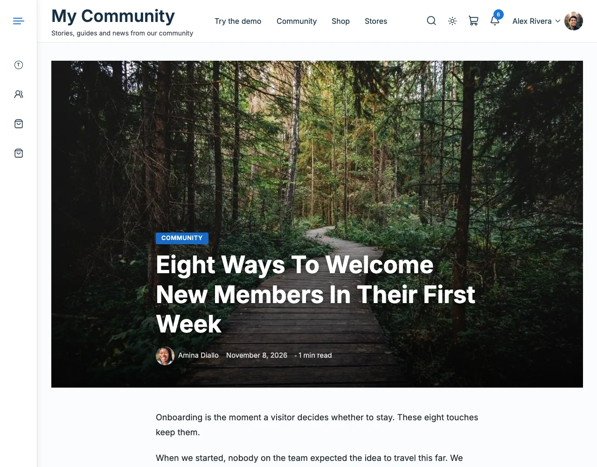
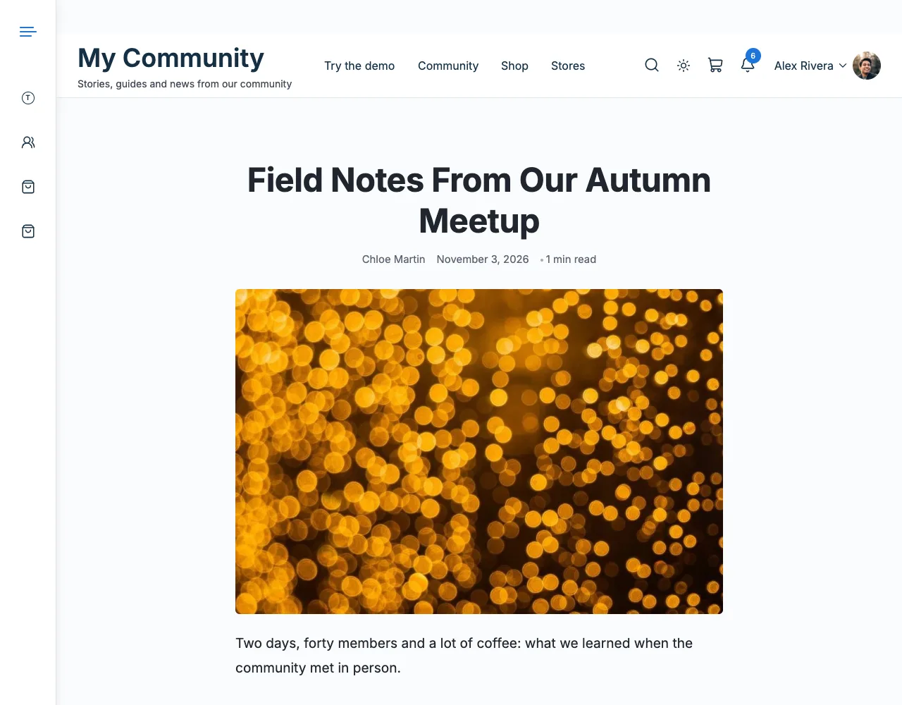
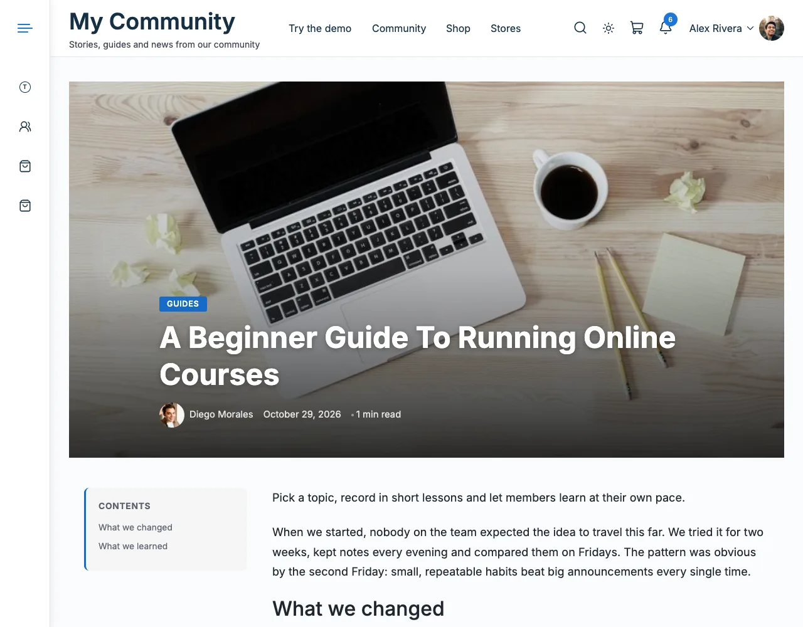
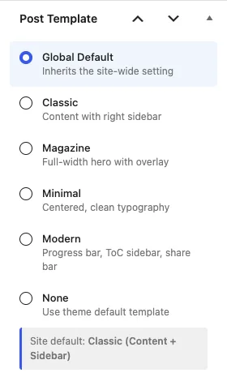
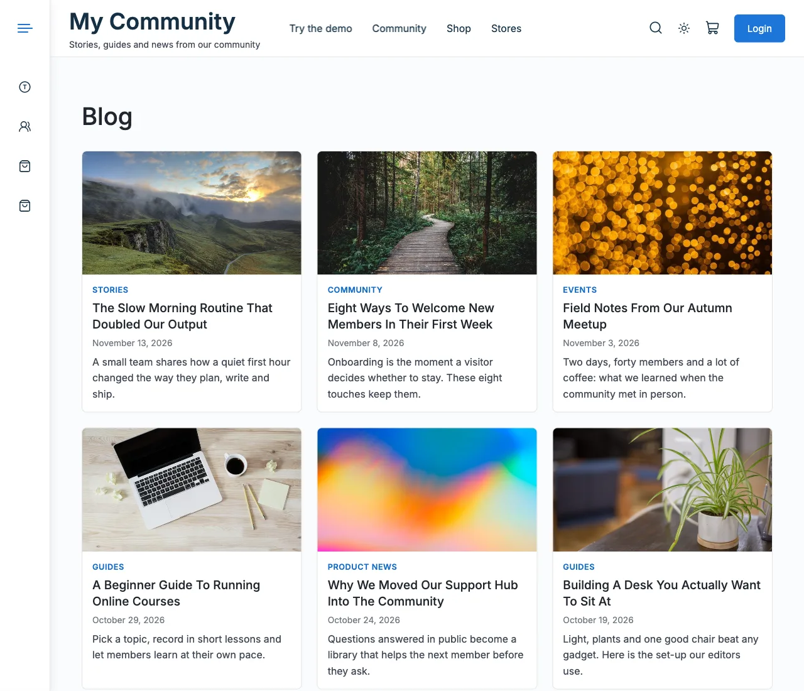
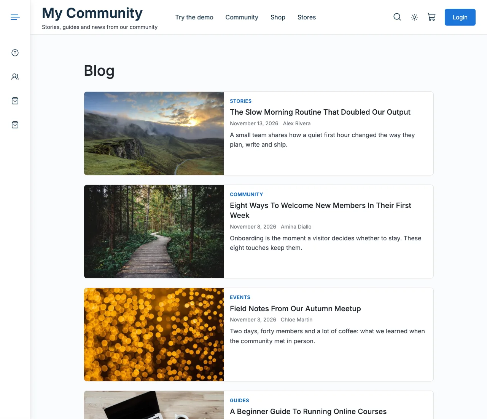
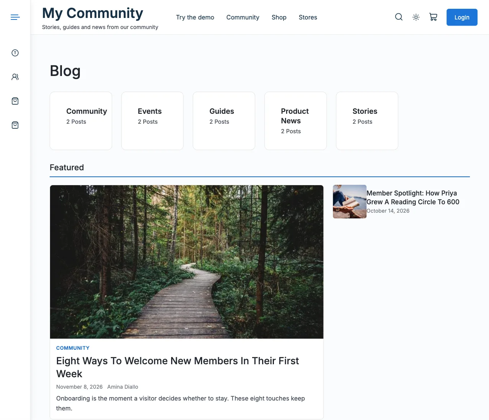
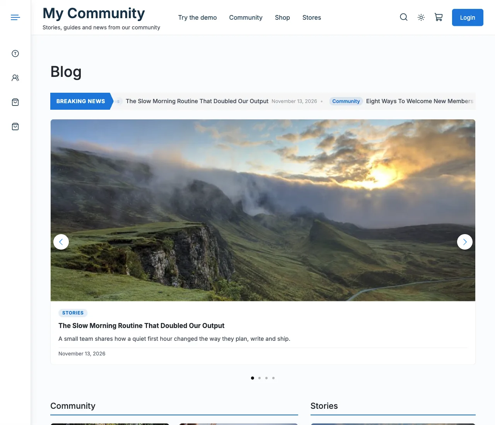

# Blog page and post layouts (Blog layouts and post templates)

**Also called:** blog layout, news page, post template, single post layout, magazine layout, newspaper layout, archive layout, table of contents.

## What this does

Wbcom Essential can change how your blog page, archives and single posts look, without a page builder. You choose a layout in the plugin settings. You can also override the post layout on any one post.

## Steps

1. In the admin menu, go to **Wbcom Designs > Essential**.
2. Open the **Settings** tab.
3. Choose your layouts, as described below.
4. Click **Save Changes** at the bottom.

The **Overview** tab next to it shows how many blocks and widgets are available.

## Post layout for every post

Under **Post Templates**, **Default Single Post Template** sets the layout every blog post uses.

| Choice | What visitors see |
|--------|-------------------|
| None (Use Theme Default) | Your theme's own single post layout. This is the default. |
| Classic (Content + Sidebar) | The post with your theme's right sidebar (the sidebar that holds your widgets on Reign, BuddyX and BuddyX Pro), followed by author bio, related posts and previous/next links. With no widgets in that sidebar, the post uses the full width. |
| Magazine (Full-Width Hero) | A full-width hero image with the title over it, share buttons, author bio, related posts and previous/next links. |
| Minimal (Centered, Clean) | A centered, clean reading layout with author bio, related posts and previous/next links. |
| Modern (Progress Bar + ToC) | A reading progress bar, a table of contents sidebar, a share bar, author bio, related posts and previous/next links. |

The templates apply to the standard **Post** type only. Pages and other post types keep your theme's layout.

### Change the layout of one post

1. Edit the post.
2. Find the **Post Template** box on the post edit screen.
3. Choose one of **Global Default**, **Classic**, **Magazine**, **Minimal**, **Modern** or **None**. **Global Default** follows the site setting. **None** uses the theme default for this post, even if a site default is set.
4. Update the post.

The box shows the current site default so you can see what **Global Default** means.

### How does the table of contents work in the Modern layout?

The table of contents lists the post's headings. When two headings have the same text, each link goes to its own heading.

## Blog page layout

Under **Blog Index**, set how your posts page and archives look.

| Setting | What it does |
|---------|--------------|
| Blog Layout | None (Use Theme Default), Grid (Card Layout), List (Horizontal Cards), Magazine (Multi-Section) or Newspaper (Breaking News). Applies to the main blog page and to category, tag, author and date archives. Magazine and Newspaper are built for the main blog page. On archives they show that archive's posts as a grid. |
| Posts Per Page | How many posts per page, 0 to 50. 0 uses the WordPress default. Applies to the Grid and List layouts, and to archives. In Magazine and Newspaper each section sets its own count, and the last section carries the page numbers. |
| Layout Options | Extra switches for the chosen layout, described below. |
| Content Sections | The sections of a Magazine or Newspaper layout, described below. |

### Layout options

| Layout | Option | What it does |
|--------|--------|--------------|
| Magazine | Show category navigation bar | Shows a bar of category links above the sections. On by default. |
| Newspaper | Show breaking news ticker | Shows a scrolling ticker of the latest headlines. On by default. |
| Newspaper | Show hero slider | Shows a large slider of top stories. On by default. |
| Grid, List | None | These layouts have no extra options. |

### What each layout looks like

Every layout follows the theme's colours, including dark mode. On phones, every layout stacks to one column.

### Content sections (Magazine and Newspaper)

Magazine and Newspaper build the page from sections. Each section is a row with:

- **Section title**: the heading above the section. Leave it empty to use the category name.
- **Category**: **Auto (random with posts)**, **All Categories (Latest)** or one of your categories.
- **Display Style**: Hero + Sidebar, Featured + List, Grid (Columns), Side by Side, Hero + Text Sidebar, Magazine (1+3+Rest) or Two Featured + List.
- **Posts**: how many posts the section shows, 1 to 20.

Click **Add Section** to add a row. Drag a row by its handle to reorder it. Use the bin icon to remove it. With **Auto**, the plugin picks categories that have posts, so the sections are never empty. Each layout starts with a ready set of sections you can edit.

## You'll know it worked when

Your blog page shows the layout you picked, and a single post shows its template. Reload the page after you save.

## Related

- [Ready-made page sections (Block patterns)](block-patterns.md) for ready-made blog and post sections
- [Blog blocks](../blocks/blog-blocks.md)
- [Theme colours](theme-colors.md)
