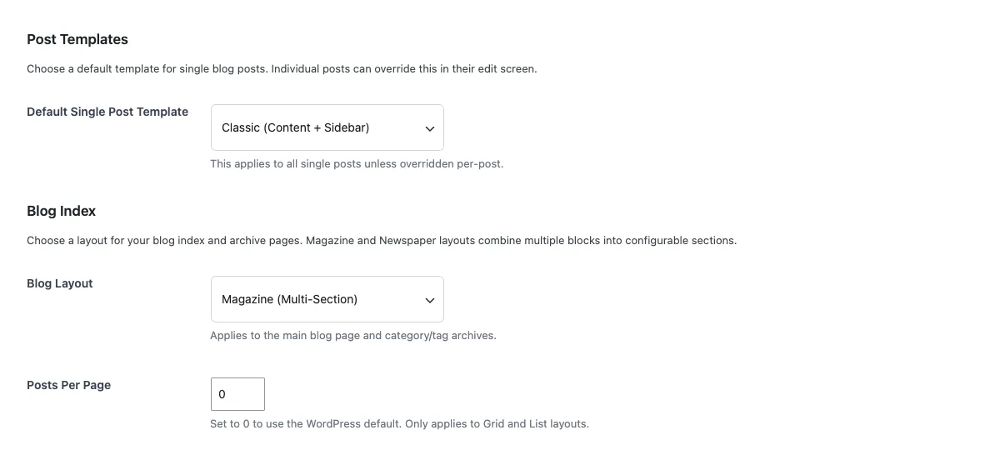
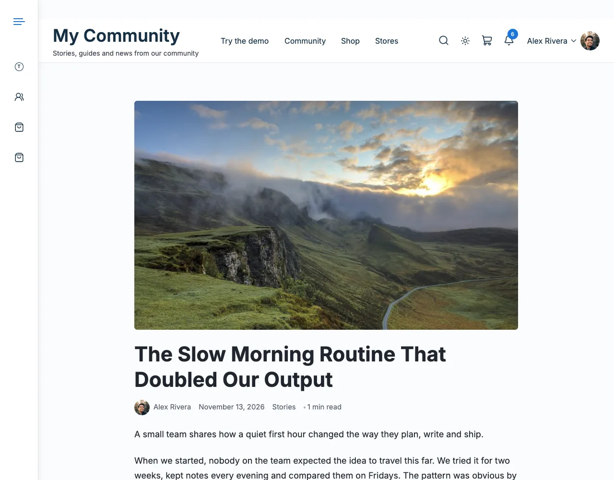
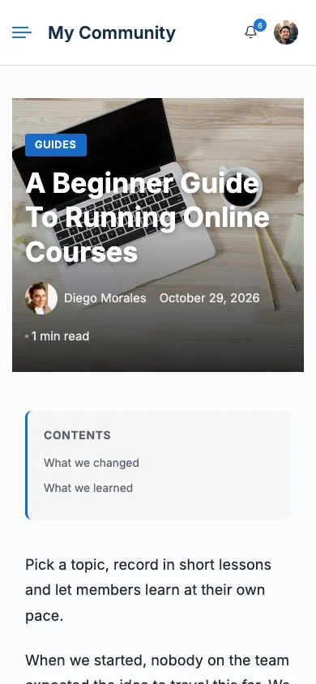
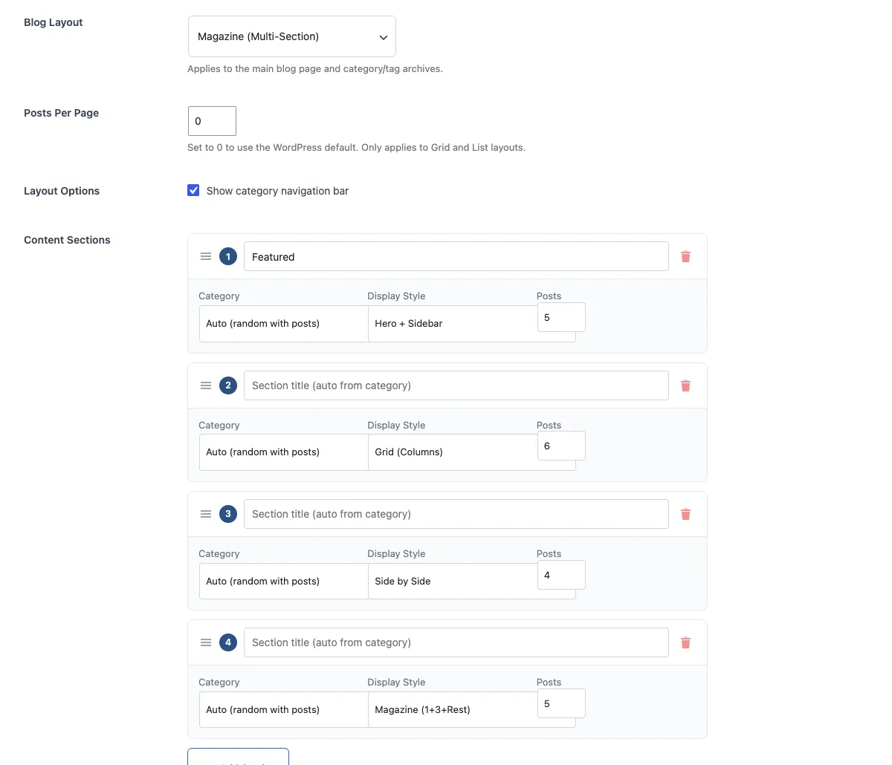
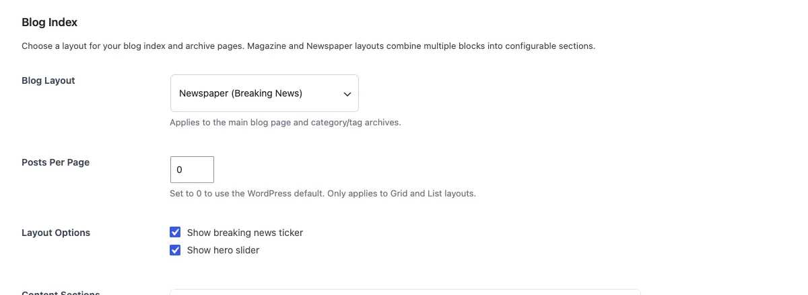

# Blog Layouts and Post Templates

Wbcom Essential can change how your blog page, archives and single posts look, without a page builder. You choose a layout in the plugin settings, and you can override the single post template on any post.

Both settings are on one screen: go to **Wbcom Designs > Essential** in the admin menu and open the **Settings** tab. Click **Save Changes** at the bottom. The **Overview** tab next to it shows how many blocks and widgets are available.

## Default single post template

Under **Post Templates**, **Default Single Post Template** sets the layout every single blog post uses.

| Choice | What visitors see |
|--------|-------------------|
| None (Use Theme Default) | Your theme's own single post layout. This is the default. |
| Classic (Content + Sidebar) | The post with a sidebar on the right, followed by author bio, related posts and previous/next links. |
| Magazine (Full-Width Hero) | A full-width hero image with the title over it, share buttons, author bio, related posts and previous/next links. |
| Minimal (Centered, Clean) | A centered, clean reading layout with author bio, related posts and previous/next links. |
| Modern (Progress Bar + ToC) | A reading progress bar, a table of contents sidebar, a share bar, author bio, related posts and previous/next links. |

The templates apply to the standard **Post** type only. Pages and other post types keep your theme's layout.

### Change one post

1. Edit the post.
2. Find the **Post Template** box on the post edit screen.
3. Choose one of: **Global Default** (follow the site setting), **Classic**, **Magazine**, **Minimal**, **Modern** or **None** (use the theme default for this post, even if a site default is set).
4. Update the post.

The box shows the current site default so you can see what **Global Default** means.

### The Modern template's table of contents

The table of contents lists the post's headings. When two headings have the same text, each link goes to its own heading.

## Blog index layout

Under **Blog Index**, set how your posts page and archives look.

| Setting | What it does |
|---------|--------------|
| Blog Layout | None (Use Theme Default), Grid (Card Layout), List (Horizontal Cards), Magazine (Multi-Section) or Newspaper (Breaking News). Applies to the main blog page and category, tag, author and date archives. |
| Posts Per Page | How many posts per page, 0 to 50. 0 uses the WordPress default. Applies to the Grid and List layouts only. |
| Layout Options | Extra switches for the chosen layout, described below. |
| Content Sections | The sections of a Magazine or Newspaper layout, described below. |

### Layout options

| Layout | Option | What it does |
|--------|--------|--------------|
| Magazine | Show category navigation bar | Shows a bar of category links above the sections. On by default. |
| Newspaper | Show breaking news ticker | Shows a scrolling ticker of the latest headlines. On by default. |
| Newspaper | Show hero slider | Shows a large slider of top stories. On by default. |
| Grid, List | None | These layouts have no extra options. |

### Content sections (Magazine and Newspaper)

Magazine and Newspaper build the page from sections. Each section is a row with:

- **Section title**: the heading above the section. Leave it empty to use the category name.
- **Category**: **Auto (random with posts)**, **All Categories (Latest)** or one of your categories.
- **Display Style**: Hero + Sidebar, Featured + List, Grid (Columns), Side by Side, Hero + Text Sidebar, Magazine (1+3+Rest) or Two Featured + List.
- **Posts**: how many posts the section shows, 1 to 20.

Click **Add Section** to add a row, drag a row by its handle to reorder it, and use the bin icon to remove it. With **Auto**, the plugin picks categories that have posts, so the sections are never empty. Each layout starts with a ready set of sections you can edit.

## Related

- [Block Patterns](block-patterns.md) for ready-made blog and post sections
- [Blog Blocks](../blocks/blog-blocks.md)
- [Theme Colors](theme-colors.md)
