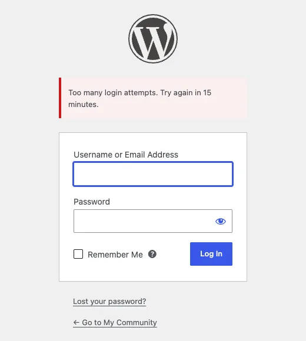

# Sign-in protection (Login security)

**Also called:** login protection, brute force protection, too many login attempts, locked out, spam trap, honeypot, bot protection.

## What this does

Wbcom Essential protects the sign-in forms it provides. The protection is on by default and needs no setup. It stops bots that fill in hidden fields. It also slows down anyone who guesses passwords.

| Protection | How it works |
|------------|--------------|
| Lockout | After 5 failed sign-ins from the same IP address, that address is locked out for 15 minutes. A successful sign-in clears the count. |
| Spam trap (honeypot) | The Elementor Login Form widget and the EDD Account Dashboard login form have a hidden field that people never see. A sign-in that fills it in is rejected with "Login attempt rejected." |
| Same message for every wrong login | The Elementor Login Form widget says "The username or password is incorrect. Please try again." for an unknown username and for a wrong password. It does not reveal which usernames exist. |

The lockout covers any sign-in that goes through WordPress's own login check. That includes `wp-login.php`, the Elementor Login Form widget, the Login Form block and the EDD Account Dashboard login.

## Steps

You do not need to do anything. To check that it works:

1. Open a sign-in form on your site in a private browser window.
2. Enter a wrong password 5 times in a row.
3. Try a sixth time.

## You'll know it worked when

You see "Too many login attempts. Try again in N minutes." The lockout is per IP address, so other visitors are not affected.



## Good to know

### How do I get back in after a lockout?

Wait for the time shown in the message. The lockout ends on its own after 15 minutes.

### Why does the lockout hit many visitors at once?

If your site sits behind Cloudflare or a load balancer, every visitor can look like they come from one address. Tell the plugin which proxy addresses to trust, as shown under For developers.

### Can I change the limits or turn it off?

Yes. A developer or site builder can change the number of attempts and the lockout time. You can also switch the protection off if you run a security plugin such as Wordfence or Solid Security. See For developers.

## For developers

### Sites behind a proxy or CDN

By default the lockout uses the visitor's IP address as the server sees it. Headers such as `X-Forwarded-For` are ignored, because a visitor can fake them.

List your proxy's addresses so the lockout can read the real visitor address. Add this to a small plugin or your child theme's `functions.php`:

```php
add_filter( 'wbcom_essential_login_security_trusted_proxies', function () {
	return array( '203.0.113.10', '198.51.100.0/24', '2001:db8::/32' );
} );
```

Each entry is an IP address or a range in CIDR form, IPv4 or IPv6. Only requests from a listed proxy are read from the forwarded headers (`CF-Connecting-IP`, `X-Forwarded-For`, then `X-Real-IP`). Use the address ranges your proxy publishes.

### Change the limits

The defaults are 5 failed attempts and a 15-minute lockout. To change them, add these lines to `wp-config.php` above the line that says "That's all, stop editing":

```php
define( 'WBCOM_ESSENTIAL_LOGIN_MAX_ATTEMPTS', 10 );
define( 'WBCOM_ESSENTIAL_LOGIN_LOCKOUT_MINUTES', 30 );
```

### Turn the protection off

```php
add_filter( 'wbcom_essential_login_security_enabled', '__return_false' );
```

To change how the IP address is worked out, filter `wbcom_essential_login_security_client_ip`. See [Hooks and Filters](../developer-guide/hooks-and-filters.md).

## Related

- [Design and content widgets](../widgets/general-widgets.md) for the Login Form widget
- [Content blocks](../blocks/content-blocks.md) for the Login Form block
- [Troubleshooting](../troubleshooting/troubleshooting.md)
