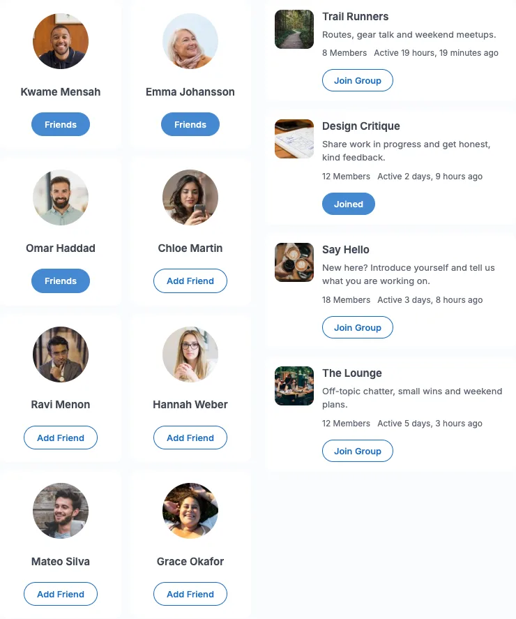

# Phone and tablet layouts (Responsive design)

**Also called:** mobile layout, mobile view, hide on mobile, tablet view, columns on phone, breakpoints, device visibility.

## What this does

Wbcom Essential blocks and widgets let you set layout and visibility for desktop, tablet and mobile. Blocks and Elementor widgets do this in different ways.

## Breakpoints in blocks

The blocks use these breakpoints:

| Device | Screen width |
|--------|--------------|
| Desktop | Wider than 1024px |
| Tablet | 768px to 1024px |
| Mobile | 767px and narrower |

In the block editor, switch device with the preview buttons in the toolbar. Responsive settings then apply to the device you are previewing.

## Responsive settings in blocks

| Setting | Where it appears |
|---------|------------------|
| Device Visibility | All 35 blocks. |
| Padding and margin per device | Blocks with a spacing control, such as Hero, Promo Banner, Timeline, Category Grid, Groups Grid and Activity Feed. The control has Desktop, Tablet and Mobile tabs; a smaller screen follows the larger one until you set its own value. With the sides unlinked, the four sides show two by two with labels. |
| Columns per device | The grid blocks: Category Grid, Groups Grid, Members Grid, Portfolio Grid and Product Grid. |

### Phone layouts

On phones the blocks are laid out to read well without any setting:

- Members Grid starts at two columns (Columns (Mobile) is 2).
- Groups Grid keeps each group as a row, with the photo on the left and the details on the right.
- Countdown Timer keeps its boxes on one row.
- Carousel dots are larger, so they are easy to tap.

You can still change the columns per device in the block settings.

### Narrow columns and sidebars

Placed in a narrow column or sidebar, Feature Grid, Pricing Table, Stats Counter, Product Grid, Category Grid and Portfolio Grid drop to fewer columns instead of squeezing their cards. Post Carousel and Product Carousel show as many slides as fit. A carousel with too few slides stops repeating cards and hides its arrows. Long words and links wrap inside the cards instead of running out of them.

### How do I hide a block on some devices?

1. Select the block.
2. Open the block settings and find **Device Visibility**.
3. Turn on **Hide on Desktop**, **Hide on Tablet** or **Hide on Mobile**.

The block stays in the editor. It is hidden on the front end for that device range only.

## Responsive settings in Elementor widgets

Elementor widgets use Elementor's own device icons. Click the device icon next to a setting, then set a value for that device. Elementor controls the breakpoint widths.

Some widgets add their own device options:

- Post Carousel can hide its arrows, dots, categories, excerpt and card footer on desktop, tablet or mobile.
- Post Slider and Slider can hide their dots and arrows on desktop, tablet or mobile.
- Site Logo and Smart Menu have a Mobile Breakpoint setting.
- WC Testimonial and Customer Review show one column on phones and two on tablets unless you set a column count for that device.
- Product Tab, Universal Product and WooCommerce Testimonial set how many slider items show on tablet and on mobile phones.

## Reduced motion

If a visitor's device asks for reduced motion, the blocks cut animations and transitions to almost nothing. This applies to every Wbcom Essential block.

## Check your layout

1. Preview the page on desktop, tablet and mobile in the editor.
2. Open the live page and resize the browser window.
3. Test on a real phone.

## You'll know it worked when

The layout changes at each width. A block you hid on mobile is gone on the phone but still in the editor.

## Related

- [Blocks overview](../blocks/blocks-overview.md)
- [Elementor widgets overview](../widgets/widgets-overview.md)
- [Page speed](performance.md)
