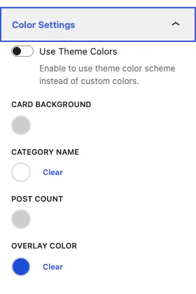

# Theme Colors

Wbcom Essential blocks and Elementor widgets can take their colours from your theme, in light and dark mode. This page explains which themes do it, which blocks follow the theme by default, and how to override a colour.

## Which themes

Reign, BuddyX and BuddyX Pro. These themes publish their colours as CSS variables (Reign uses `--reign-*`, BuddyX and BuddyX Pro use `--bx-color-*`). Wbcom Essential links them to its own `--wbcom-*` variables, so blocks and widgets pick up your accent, text, card and border colours, and switch with the theme's dark mode.

On any other theme, blocks use the built-in colours described on this page, or the `--wbcom-*` variables you set yourself (see below).

## Empty means follow the theme

Many block colour settings start empty. An empty colour follows the theme. If you pick a colour, your colour is used. To go back to the theme colour, clear the colour.



**Blocks whose colours follow the theme by default:**

| Group | Blocks |
|-------|--------|
| Marketing | Countdown Timer, CTA Section (background, heading and description), Feature Grid, Testimonial Carousel |
| Content | FAQ Accordion (question, answer, background and border), Login Form |
| Blog | Category Grid, Post Carousel, Posts Ticker |
| BuddyPress | Activity Feed, Group Carousel, Groups Grid, Members Carousel, Members Grid |
| WooCommerce | Customer Reviews, Product Carousel, Product Grid (card, title, price and Add to Cart colours) |
| EDD | The EDD blocks. Their filled buttons use the theme's button colours, so the labels stay readable in dark mode. |


**Blocks that keep their own colours until you change them:** Hero Section, Promo Banner, Pricing Table, Flip Box, Portfolio Grid, Progress Bar, Stats Counter, Tabs, Text Rotator and Timeline, plus the button colours in CTA Section, the icon colour in FAQ Accordion, the star colour in Customer Reviews and the sale badge in Product Grid. These are designed as feature sections with their own look.


Each block's page lists every colour and its default: see [Blocks Overview](../blocks/blocks-overview.md).

**Elementor widgets** work the same way. On Reign, BuddyX and BuddyX Pro, a widget colour you have not changed follows the theme in light and dark mode. A colour you set is used as you set it.

## Spacing

Blocks use your theme's spacing between blocks instead of a fixed margin of their own, so a block sits at the same distance from its neighbours as any other block. You can still set a margin in the block's Spacing or Advanced settings.

## Use Theme Colors toggle (Category Grid)

The **Category Grid** block also has a **Use Theme Colors** toggle.

1. Select a Category Grid block in the editor.
2. Open the block settings and expand **Color Settings**.
3. Turn on **Use Theme Colors**.

With the toggle on, the card takes the theme accent colour and the custom colour pickers for card background, category name, post count and overlay disappear. With the toggle off, you choose those colours yourself, and any you leave empty follow the theme. A category with no image shows a faint capital letter of its name, in the theme accent when the toggle is on.

## Theme variables

On Reign, BuddyX and BuddyX Pro these are filled in for you.

| Variable | Meaning | Reign source | BuddyX and BuddyX Pro source |
|----------|---------|--------------|------------------------------|
| `--wbcom-color-primary` | Accent colour | `--reign-accent-color` | `--bx-color-accent` |
| `--wbcom-color-primary-hover` | Accent on hover | `--reign-accent-hover-color` | `--bx-color-button-bg-hover` |
| `--wbcom-button-bg` | Button background | `--reign-site-button-bg-color` | `--bx-color-button-bg` |
| `--wbcom-button-color` | Button text | `--reign-site-button-text-color` | `--bx-color-button-fg` |
| `--wbcom-link-color` | Links | `--reign-site-link-color` | `--bx-color-link` |
| `--wbcom-link-hover-color` | Links on hover | `--reign-site-link-hover-color` | `--bx-color-link-hover` |
| `--wbcom-heading-color` | Headings | `--reign-site-headings-color` | `--bx-color-heading` |
| `--wbcom-text-color` | Body text | `--reign-site-body-text-color` | `--bx-color-fg` |
| `--wbcom-card-bg` | Card background | `--reign-site-sections-bg-color` | `--bx-color-bg-elevated` |
| `--wbcom-color-border` | Borders | `--reign-site-border-color` | `--bx-color-border` |
| `--wbcom-color-base` | Page background | `--reign-site-body-bg-color` | `--bx-color-bg` |
| `--wbcom-color-base-2` | Alternate background | `--reign-site-secondary-bg-color` | `--bx-color-bg-muted` |

### Use another theme

On any other theme, add the variables you want to your theme CSS, for example in **Appearance > Customize > Additional CSS**. A variable you define yourself wins over the built-in link to the theme.

```css
:root {
  --wbcom-color-primary: #1d76da;
  --wbcom-link-color: #1d76da;
  --wbcom-heading-color: #222222;
  --wbcom-text-color: #333333;
  --wbcom-card-bg: #ffffff;
  --wbcom-color-border: #e2e5ea;
}
```

Dark mode is read from the `data-bx-mode="dark"` attribute on the page, which Reign and BuddyX set (BuddyX Pro uses the `buddyx-dark-theme` class on the body). On another theme, set your dark values inside `html[data-bx-mode="dark"]` if you want the blocks to follow.

## Shared design tokens

The plugin also loads a set of `--wbe-` design tokens on pages that use its blocks. They cover spacing, radius, shadows, font sizes, status colours, and surface, text and border colours that follow the `--wbcom-*` variables. The accent colour token follows `--wbcom-color-primary`, then `--wbcom-link-color`.

## Troubleshooting

| Problem | What to try |
|---------|-------------|
| A block does not follow my theme colours | Check that the theme is Reign, BuddyX or BuddyX Pro, or that you defined the `--wbcom-*` variables. Then check the block's colour is empty. A colour you picked always wins. |
| A colour I picked is stuck | Clear the colour in the block sidebar to return to the theme colour. |
| The Use Theme Colors toggle is missing | Only the Category Grid block has it. |
| Colours do not change | Clear any caching plugin cache and reload the page. |
| Colours look wrong | Check that your theme defines the variable as a valid colour. Inspect the block in your browser's developer tools to see which value applies. |
| Hero, Pricing Table or Flip Box ignore my theme | They keep their own colours until you change them. See the list above. |

## Related

- [Blocks Overview](../blocks/blocks-overview.md)
- [Blog Blocks](../blocks/blog-blocks.md)
- [Reign Theme Guide](../themes/reign-theme-guide.md)
- [Responsive Design](responsive-design.md)
