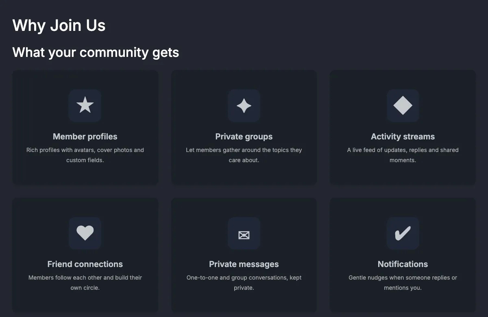

# Match your theme's colours (Theme colors)

**Also called:** theme colours, dark mode, brand colours, accent colour, change block colours, colour palette, light and dark mode.

## What this does

Wbcom Essential blocks and Elementor widgets can take their colours from your theme. They follow the theme in light and dark mode. This page says which themes do this, which blocks follow the theme, and how to use your own colour.

## Before you start

Use Reign, BuddyX or BuddyX Pro. These themes share their colours with the plugin. Your accent, text, card and border colours then reach every block and widget. On any other theme, blocks use their built-in colours. You can set your own colours as shown under For developers.

## Steps

1. Select a block in the block editor.
2. Open the block settings and find a colour setting.
3. Leave the colour empty to follow the theme. Pick a colour to use your own.
4. To go back to the theme colour, click the **Clear** button on that colour.


## You'll know it worked when

The block shows your theme's colours, and they change when you switch the theme to dark mode.





## Good to know

### Which blocks follow my theme colours?

Many block colour settings start empty, and an empty colour follows the theme. These blocks do so.

| Group | Blocks |
|-------|--------|
| Marketing | Countdown Timer, CTA Section (background, heading and description), Feature Grid, Testimonial Carousel |
| Content | FAQ Accordion (question, answer, background and border), Login Form |
| Blog | Category Grid, Post Carousel, Posts Ticker |
| BuddyPress | Activity Feed, Group Carousel, Groups Grid, Members Carousel, Members Grid |
| WooCommerce | Customer Reviews, Product Carousel, Product Grid (card, title, price and Add to Cart colours) |
| EDD | The EDD blocks. Their filled buttons use the theme's button colours, so the labels stay readable in dark mode. |

### Which blocks keep their own colours?

These blocks look like feature sections, so they keep their own colours until you change them. They are Hero Section, Promo Banner, Pricing Table, Flip Box, Portfolio Grid, Progress Bar, Stats Counter, Tabs, Text Rotator and Timeline. Some single colours also stay fixed. These are the button colours in CTA Section and the icon colour in FAQ Accordion. They also include the star colour in Customer Reviews and the sale badge in Product Grid.


Each block's page lists every colour and its default. See [Blocks overview](../blocks/blocks-overview.md).

### Do Elementor widgets follow the theme too?

Yes. On Reign, BuddyX and BuddyX Pro, a widget colour you have not changed follows the theme in light and dark mode. A colour you set is used as you set it.

### How much space is there between blocks?

Blocks use your theme's spacing between blocks, not a fixed margin of their own. You can still set a margin in the block's Spacing or Advanced settings.

### What is the Use Theme Colors switch?

Only the Category Grid block has it.

1. Select a Category Grid block in the editor.
2. Open the block settings and expand **Color Settings**.
3. Turn on **Use Theme Colors**.

With the switch on, the card takes the theme accent colour. The colour pickers for card background, category name, post count and overlay disappear. With the switch off, you choose those colours yourself, and any you leave empty follow the theme. A category with no image shows a faint capital letter of its name.

### A block does not follow my theme colours. What now?

Check that the theme is Reign, BuddyX or BuddyX Pro. Then check that the block's colour is empty, because a colour you picked always wins. Hero, Pricing Table and Flip Box keep their own colours, as listed above.

### A colour I picked is stuck. How do I undo it?

Click **Clear** on the colour in the block sidebar.

### The colours do not change. What now?

Clear your caching plugin's cache and reload the page. If a colour still looks wrong, check that your theme defines the variable as a valid colour. Inspect the block in your browser's developer tools to see which value applies.

## For developers

Reign publishes its colours as `--reign-*` variables. BuddyX and BuddyX Pro use `--bx-color-*`. Wbcom Essential links them to its own `--wbcom-*` variables.

### Theme variables

On Reign, BuddyX and BuddyX Pro these are filled in for you.

| Variable | Meaning | Reign source | BuddyX and BuddyX Pro source |
|----------|---------|--------------|------------------------------|
| `--wbcom-color-primary` | Accent colour | `--reign-accent-color` | `--bx-color-accent` |
| `--wbcom-color-primary-hover` | Accent on hover | `--reign-accent-hover-color` | `--bx-color-button-bg-hover` |
| `--wbcom-button-bg` | Button background | `--reign-site-button-bg-color` | `--bx-color-button-bg` |
| `--wbcom-button-color` | Button text | `--reign-site-button-text-color` | `--bx-color-button-fg` |
| `--wbcom-link-color` | Links | `--reign-site-link-color` | `--bx-color-link` |
| `--wbcom-link-hover-color` | Links on hover | `--reign-site-link-hover-color` | `--bx-color-link-hover` |
| `--wbcom-heading-color` | Headings | `--reign-site-headings-color` | `--bx-color-heading` |
| `--wbcom-text-color` | Body text | `--reign-site-body-text-color` | `--bx-color-fg` |
| `--wbcom-card-bg` | Card background | `--reign-site-sections-bg-color` | `--bx-color-bg-elevated` |
| `--wbcom-color-border` | Borders | `--reign-site-border-color` | `--bx-color-border` |
| `--wbcom-color-base` | Page background | `--reign-site-body-bg-color` | `--bx-color-bg` |
| `--wbcom-color-base-2` | Alternate background | `--reign-site-secondary-bg-color` | `--bx-color-bg-muted` |

### Use another theme

On any other theme, add the variables you want to your theme CSS, for example in **Appearance > Customize > Additional CSS**. A variable you define yourself wins over the built-in link to the theme.

```css
:root {
  --wbcom-color-primary: #1d76da;
  --wbcom-link-color: #1d76da;
  --wbcom-heading-color: #222222;
  --wbcom-text-color: #333333;
  --wbcom-card-bg: #ffffff;
  --wbcom-color-border: #e2e5ea;
}
```

Dark mode is read from the `data-bx-mode="dark"` attribute on the page. Reign and BuddyX set it. BuddyX Pro uses the `buddyx-dark-theme` class on the body. On another theme, set your dark values inside `html[data-bx-mode="dark"]` if you want the blocks to follow.

### Shared design tokens

The plugin also loads a set of `--wbe-` design tokens on pages that use its blocks. They cover spacing, radius, shadows, font sizes and status colours. They also cover surface, text and border colours that follow the `--wbcom-*` variables. The accent colour token follows `--wbcom-color-primary`, then `--wbcom-link-color`.

## Related

- [Blocks overview](../blocks/blocks-overview.md)
- [Blog blocks](../blocks/blog-blocks.md)
- [Reign theme guide](../themes/reign-theme-guide.md)
- [Phone and tablet layouts](responsive-design.md)
