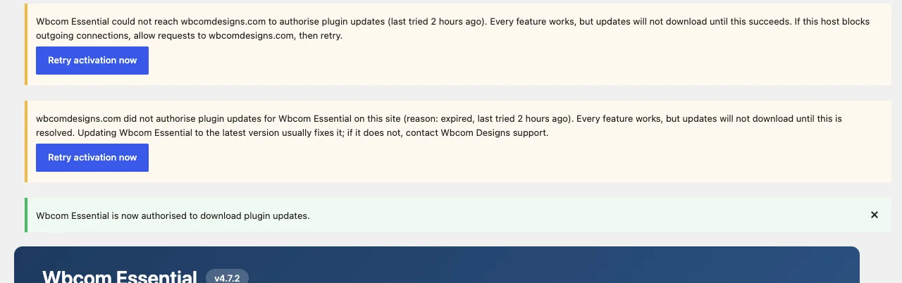

# Plugin updates and licence key (Updates and licence)

**Also called:** plugin update, update not showing, licence key, license, activation notice, retry activation, auto update, download update.

## What this does

Wbcom Essential is free. It still has a licence key behind the scenes, but only so WordPress can download updates. No block, widget or setting depends on it.

## How updates work

- Update checks and downloads go to `updates.wbcomdesigns.com`. If that server cannot be reached, the plugin falls back to `wbcomdesigns.com`.
- Updates appear under **Dashboard > Updates** like any other plugin update.
- Each update package carries a release signature, and the plugin checks it. A package that fails the check is reported and logged. It is not blocked.

## What is sent, and when

Shortly after you activate the plugin, it contacts the Wbcom Designs update server once in the background to authorise updates. It sends these three things.

- the plugin's licence key
- the product id
- your site address (home URL)

It sends nothing else, and no visitor or user data. The same list is in the plugin's External Services section in `readme.txt`. See the [privacy policy](https://wbcomdesigns.com/privacy-policy/).

If the server cannot be reached, the plugin tries again every hour, up to 24 times. If the server says no, it stops.

## Steps: fix the activation notice

If activation does not succeed, an admin notice appears with a **Retry activation now** button. It comes in two wordings.

1. Read the start of the notice.
2. If it says "Wbcom Essential could not reach wbcomdesigns.com to authorise plugin updates", the server did not answer. Allow outgoing requests to `wbcomdesigns.com` and `updates.wbcomdesigns.com` on your host or firewall.
3. If it says "wbcomdesigns.com did not authorise plugin updates for Wbcom Essential on this site", the server said no. Update Wbcom Essential to the latest version, which usually fixes it. If it does not, contact Wbcom Designs support.
4. Click **Retry activation now**.

## You'll know it worked when

You see "Wbcom Essential is now authorised to download plugin updates." If the retry fails again, the notice says so.

If your site has WP-Cron turned off, the plugin cannot schedule the background request. It tries once during a page load instead. If that fails, it shows the notice straight away so you can use the button.

## Good to know

### What if the update library is incomplete?

If the bundled licensing and update files are missing from the plugin folder, you see a notice that automatic updates are turned off. Every other feature works normally. Download the latest ZIP from [wbcomdesigns.com/downloads/wbcom-essential](https://wbcomdesigns.com/downloads/wbcom-essential/) and reinstall it.

## For developers

The helper `wbcom_essential_licence_request( array $params )` makes one licence request (activate, deactivate or check) through the bundled update library. It uses the same host and fallback as update checks, and returns the decoded reply or `false` when no host answered. See [Hooks and Filters](../developer-guide/hooks-and-filters.md).

## Related

- [Installation guide](../installation/installation-guide.md)
- [Troubleshooting](../troubleshooting/troubleshooting.md)
