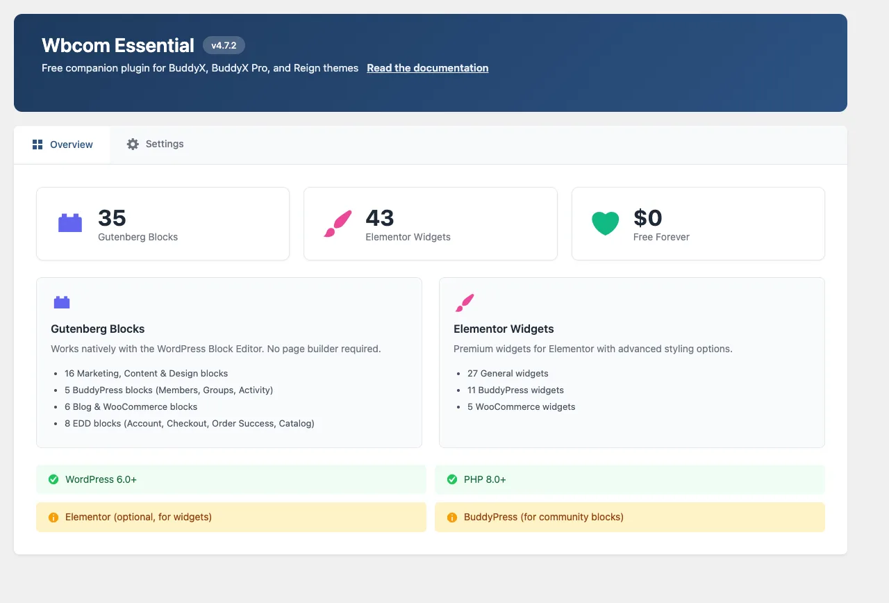

# Check that it works (After installation)

**Also called:** after install, first steps, is it working, setup checklist, find the blocks, find the widgets, plugin not showing.

## What this does

Use this checklist to confirm Wbcom Essential works on your site. Each step ends with something you can see.

## Steps

### Confirm the plugin is active

1. Go to **Plugins > Installed Plugins**.
2. Find **Wbcom Essential**.
3. Click **Activate** if it is not active.

The plugin adds a **Wbcom Designs > Essential** page to the admin menu. The **Overview** tab shows how many blocks and widgets are available. The **Settings** tab holds your blog layout and post layout choices. See [Blog page and post layouts](../features/blog-and-post-templates.md). The **Wbcom Designs** menu also has a **Dashboard** page. It lists the Wbcom plugins on your site, each with a link to its settings.

### Find the blocks

1. Edit any page or post in the block editor.
2. Click the **+** button.
3. Look for categories that start with "Essential -".

| Category | Blocks |
|----------|--------|
| Essential - Design | Flip Box, Progress Bar, Stats Counter, Text Rotator |
| Essential - Content | FAQ Accordion, Login Form, Portfolio Grid, Tabs, Timeline |
| Essential - Blog | Category Grid, Post Carousel, Posts Ticker |
| Essential - Marketing | Countdown Timer, CTA Section, Feature Grid, Hero Section, Pricing Table, Promo Banner, Testimonial Carousel |
| Essential - BuddyPress | Activity Feed, Group Carousel, Groups Grid, Members Carousel, Members Grid |
| Essential - WooCommerce | Customer Reviews, Product Carousel, Product Grid |
| Essential - EDD | Account Dashboard, Checkout blocks, Order Success, Product Catalog |

Quick test: search for "Stats Counter", insert it, and publish the page. The numbers count up when the block scrolls into view.

### Find the widgets

Widgets need Elementor.

1. Edit a page with Elementor.
2. Look for the **Wbcom Essential** category in the widget panel.
3. Search for "Progress Bar" and drag it onto the page.

BuddyPress widgets appear only when BuddyPress is active. WooCommerce widgets appear only when WooCommerce is active. The forum widgets also need bbPress. The Header Notification Area widget appears only with the Reign theme.

### Check the community, shop and downloads blocks

Set up each plugin first. See [Set up the plugins Wbcom Essential works with](set-up-companion-plugins.md).

1. Activate the plugin the block needs: BuddyPress (or BuddyBoss Platform), WooCommerce, or Easy Digital Downloads.
2. Insert a block such as **Members Grid** or **Product Grid**.
3. Confirm it shows content, not a notice.

A block that shows "BuddyPress is required for this block" or "WooCommerce plugin is required for this block" is telling you that plugin is inactive.

### Preview on the front end

1. Click **Preview** in the editor.
2. Check the page on desktop, tablet and phone sizes.

## You'll know it worked when

You can see the **Wbcom Designs > Essential** page. You can insert a block from an "Essential -" category. Your page looks right on desktop, tablet and phone.

## Good to know

### What if a block or widget is missing?

See [Troubleshooting](../troubleshooting/troubleshooting.md) or the [FAQ](../faq/faq.md).

## Related

- [Set up the plugins Wbcom Essential works with](set-up-companion-plugins.md)
- [Build your first page](getting-started.md)
- [Blocks overview](../blocks/blocks-overview.md)
- [Elementor widgets overview](../widgets/widgets-overview.md)
