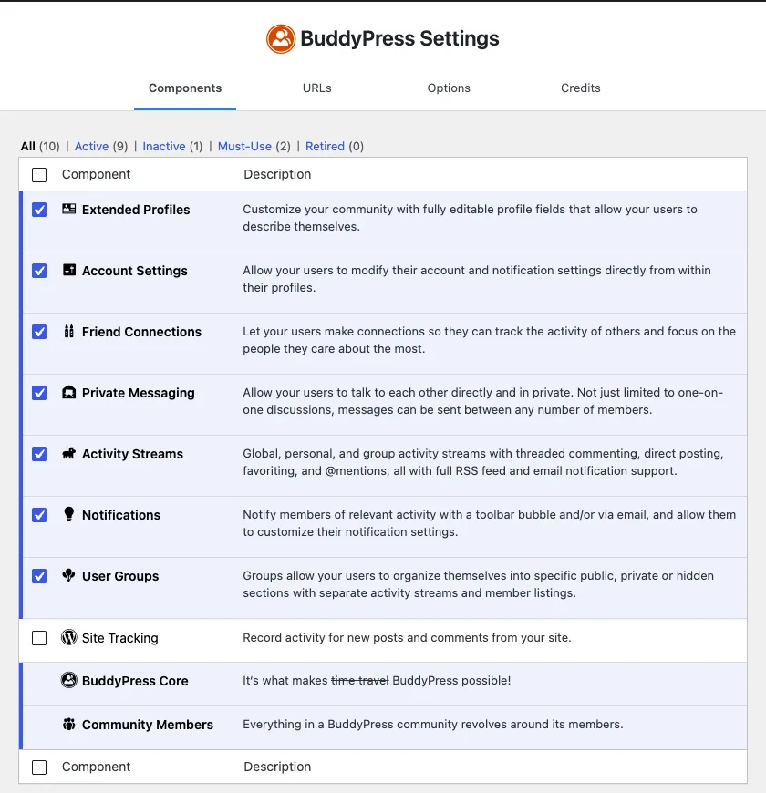
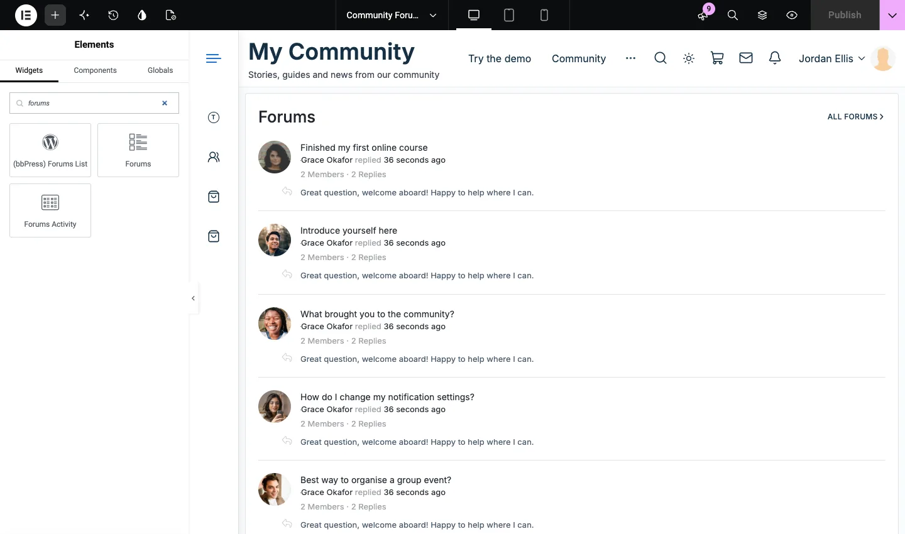
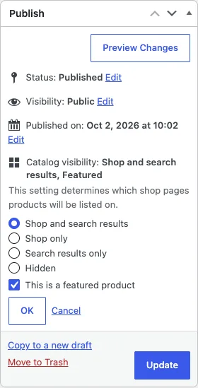
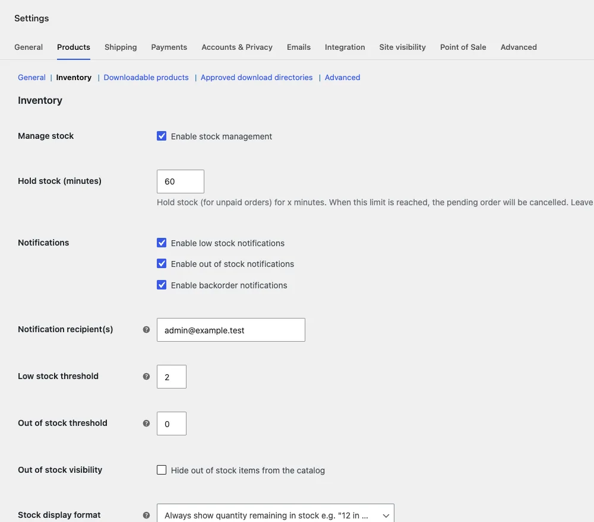
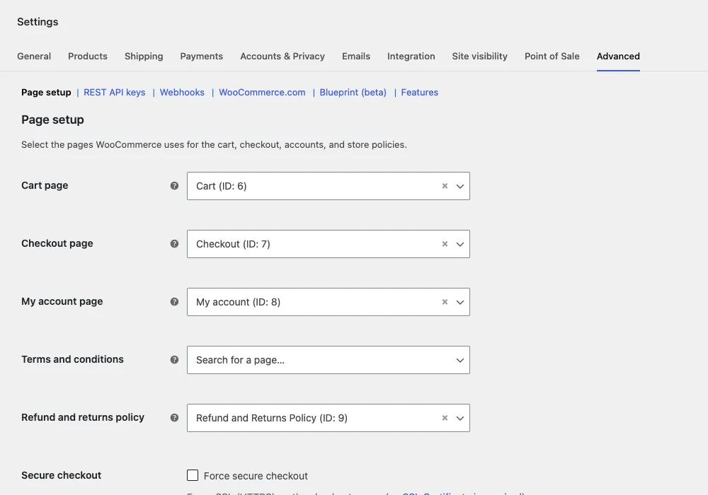
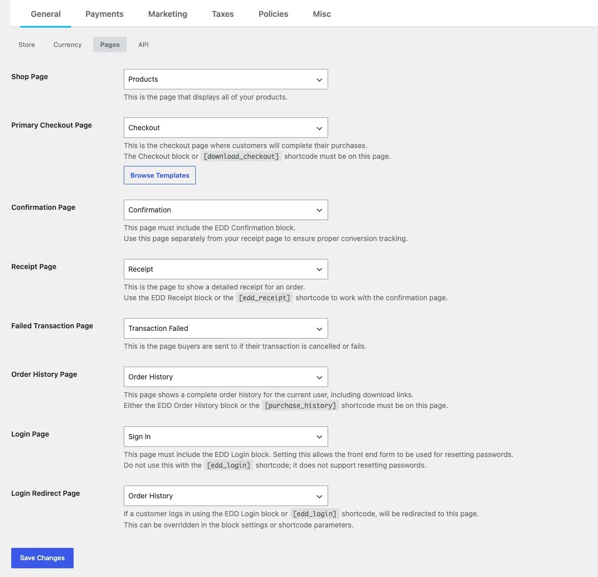
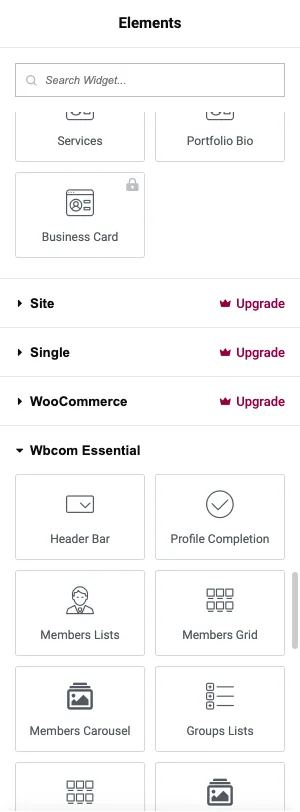

# Set up the plugins Wbcom Essential works with

**Also called:** BuddyPress setup, WooCommerce setup, store setup, community setup, forum setup, Easy Digital Downloads setup, Elementor setup, required plugins, block shows a notice.

## What this does

Some blocks and widgets show real content only when the plugin behind them is set up. This page covers five plugins: BuddyPress (community), bbPress (forums), WooCommerce (shop), Easy Digital Downloads (downloads) and Elementor (widgets). For each one it says what to install and which setting matters. Each section ends with a quick check, marked **You'll know it worked when**.

You only need the plugins for the blocks and widgets you plan to use.

| Plugin | Needed for |
|--------|------------|
| BuddyPress or BuddyBoss Platform | The 5 community blocks and the BuddyPress widgets |
| bbPress | The Forums and Forums Activity widgets |
| WooCommerce | The 3 WooCommerce blocks and the WooCommerce widgets |
| Easy Digital Downloads | The 8 EDD blocks |
| Elementor | All 43 widgets. The blocks do not need it. |

## BuddyPress

**Install:** go to **Plugins > Add New**, search for BuddyPress, then install and activate it. BuddyBoss Platform works as well.

**What matters for Wbcom Essential:** the components you switch on. Go to **Settings > BuddyPress** and open the **Components** tab. Tick the components below, then save.

| Component | What needs it |
|-----------|---------------|
| Community Members | Members Grid and Members Carousel blocks, and the Members widgets. This one is always on. |
| User Groups | Groups Grid and Group Carousel blocks, and the Groups widgets. Without it the Groups widgets do not appear in Elementor. |
| Activity Streams | The Activity Feed block. |
| Friend Connections | The Add Friend button on Members Grid and Members Carousel, and the friend requests in the header widgets. |
| Notifications | The notifications icon in the Header Bar and Header Notification Area widgets. |
| Private Messaging | The messages icon in the Header Bar and Header Notification Area widgets. |
| Extended Profiles | Profile fields. The Profile Completion widget measures how many of them a member has filled in. |

**You'll know it worked when:**

1. Add a **Members Grid** block to a page and preview it.
2. You should see member cards. If you see "BuddyPress is required for this block", BuddyPress is not active.
3. If you see "No members found", your site has no members to list yet. See [Troubleshooting](../troubleshooting/troubleshooting.md).

Learn more in the [BuddyPress documentation](https://codex.buddypress.org/).

## BuddyNext sites

The 5 community blocks (Activity Feed, Members Grid, Members Carousel, Groups Grid and Group Carousel) and the BuddyPress widgets need BuddyPress or BuddyBoss Platform. Each one checks that BuddyPress is loaded before it draws anything. BuddyNext is a separate community platform and does not load BuddyPress. So Wbcom Essential has no BuddyNext support. On a BuddyNext site without BuddyPress or BuddyBoss, those blocks show "BuddyPress is required for this block." The BuddyPress widgets do not appear.

Everything else works on a BuddyNext site, because it does not depend on the community plugin. That covers the design, content, blog and marketing blocks. It also covers the WooCommerce and Easy Digital Downloads blocks when those plugins are active. Use BuddyNext's own blocks for members, groups and activity.

Do not run BuddyPress next to BuddyNext only to make the community blocks show. See [BuddyPress Integration](../themes/buddypress-integration.md) for what the blocks need.

## bbPress

**Install:** go to **Plugins > Add New**, search for bbPress, then install and activate it.

**What matters for Wbcom Essential:** only that bbPress is active. The **Forums** and **Forums Activity** Elementor widgets are registered only when bbPress is active, and they also need BuddyPress. Create at least one forum under **Forums > New Forum** so the widgets have something to list.

**You'll know it worked when:**

1. Edit a page with Elementor.
2. Search the panel for **Forums**. The widget appears under **Wbcom Essential**.
3. Drop it on the page. It lists your forums.

Learn more in the [bbPress documentation](https://codex.bbpress.org/).

## WooCommerce

**Install:** go to **Plugins > Add New**, search for WooCommerce, then install and activate it. Run its setup wizard so the shop pages are created.

**What matters for Wbcom Essential:** these four settings.

- **Shop pages.** Go to **WooCommerce > Settings > Advanced** and open **Page setup** to confirm the Shop, Cart and Checkout pages are set.
- **Hidden products.** On a product's edit screen, **Catalog visibility** in the Publish box controls where the product shows. Product Grid and Product Carousel leave out products whose visibility hides them from the shop.
- **Out-of-stock products.** Go to **WooCommerce > Settings > Products** and open **Inventory**. Under **Out of stock visibility**, tick **Hide out of stock items from the catalog** if you want sold-out products gone. Product Grid and Product Carousel follow this setting, the same way your shop pages do.
- **Reviews.** Customer Reviews shows approved product reviews. Under **WooCommerce > Settings > Products > General**, **Enable product reviews** must be on.

**You'll know it worked when:**

1. Add a **Product Grid** block to a page.
2. Mark one product as hidden (Catalog visibility: Hidden) and update it.
3. Reload the page. That product is not in the grid, and it is not in your shop either.

Learn more in the [WooCommerce documentation](https://woocommerce.com/documentation/).

## Easy Digital Downloads

**Install:** go to **Plugins > Add New**, search for Easy Digital Downloads, then install and activate it. Its setup wizard creates the store pages.

**What matters for Wbcom Essential:** the pages EDD uses. Go to **Downloads > Settings > General** and open **Pages**.

| EDD setting | What to set | Wbcom Essential block |
|-------------|-------------|-----------------------|
| Primary Checkout Page | A page with the EDD Checkout block. | Add the Checkout Progress, Trust Badges, Social Proof and Recommendations blocks inside the EDD Checkout block. |
| Receipt Page (called Success Page on older EDD versions) | The page that shows the buyer's receipt after paying. | Put the **EDD Order Success** block here. It shows the receipt. |
| Order History Page (called Purchase History Page on older EDD versions) | Your customer account page. | The Order Success "account" card links to the page that holds the **EDD Account Dashboard** block. If no page has that block, it uses this setting, then the home page. |
| Shop Page | The page that lists your products. | A good home for the **Product Catalog** block. |
| Failed Transaction Page | Where buyers go when payment fails. | None needed. |

To set a page, choose it in the dropdown next to the setting and click **Save Changes**. Create the pages first under **Pages > Add New**.

**You'll know it worked when:**

1. Open your checkout page with a download in the cart. The checkout blocks show. Checkout Recommendations also needs the EDD Recommended Products add-on and a cart with suggestions; without them it shows nothing.
2. Buy a free download. Open the Receipt Page from the purchase confirmation. The Order Success block shows the receipt.
3. Log in and open the page with the Account Dashboard block. You see Dashboard, Downloads and Order History.

Learn more in the [Easy Digital Downloads documentation](https://easydigitaldownloads.com/docs/).

## Elementor

**Install:** go to **Plugins > Add New**, search for Elementor, then install and activate it. You need Elementor 3.5 or later. If it is older, Wbcom Essential shows a notice with an **Update Elementor** button.

**What matters for Wbcom Essential:** Elementor is needed only for the widgets. The 35 blocks work in the block editor without it. If Elementor is missing, you see a dismissible notice you can ignore.

**You'll know it worked when:**

1. Edit any page with **Edit with Elementor**.
2. Find the **Wbcom Essential** category in the widget panel.
3. Drag the **Progress Bar** widget onto the page.

If the category is missing, go to **Elementor > Tools** and click **Regenerate CSS & Data**, then reload the editor.

Learn more in the [Elementor Help Center](https://elementor.com/help/).

## Related

- [After Installation](after-installation.md)
- [Installation Guide](../installation/installation-guide.md)
- [BuddyPress Integration](../themes/buddypress-integration.md)
- [WooCommerce Integration](../themes/woocommerce-integration.md)
- [Troubleshooting](../troubleshooting/troubleshooting.md)
