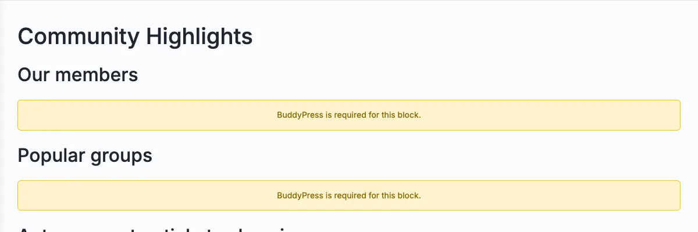
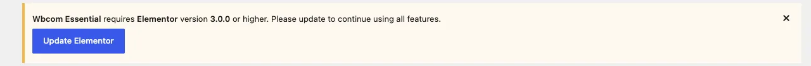

# Messages and Notices

Paste the message you see into the search box of this help site, or find it in the tables below. Each row says what the message means and what to do.

## Plugin required

These appear where a block would be, on the page and in the editor.

| Message | Cause | Fix |
|---------|-------|-----|
| BuddyPress is required for this block. | BuddyPress or BuddyBoss Platform is not active. | Activate it. See [Set up the plugins Wbcom Essential works with](../intro/set-up-companion-plugins.md). |
| WooCommerce plugin is required for this block. | WooCommerce is not active. | Activate WooCommerce. |
| Easy Digital Downloads is required for this block. | Easy Digital Downloads is not active. | Activate Easy Digital Downloads. |
| Easy Digital Downloads plugin is required for this block. | The same, shown by the Product Catalog block. | Activate Easy Digital Downloads. |
| Easy Digital Downloads is required to display this block. | The same, shown by the Account Dashboard block. | Activate Easy Digital Downloads. |

## Nothing to show

These are not errors. The block works and has nothing to list.

| Message | What to check |
|---------|---------------|
| No members found. | Your site has no members to list, or the block's filters exclude them. |
| No groups found. | There are no groups to list yet. If the block shows nothing at all, enable the User Groups component at **Settings > BuddyPress**. |
| No categories found. | No category matches the block's selection, or empty categories are hidden. |
| No posts found. | No post matches the block's settings. |
| No portfolio items found. | The Portfolio Grid has no items for the chosen filter. |
| No products found. | No visible product matches. Products hidden from the shop, and out-of-stock products when your store hides them, are left out on purpose. Check **WooCommerce > Settings > Products > Inventory**. |
| No reviews found. | No approved product reviews yet. Check **Enable product reviews** under **WooCommerce > Settings > Products**. |
| No products found matching your filters. | The Product Catalog filters match nothing. Clear the search or filters. |
| No items match your search or filter. Try clearing them. | An Account Dashboard Downloads or Licenses search found nothing. Clear the search box and filter. |
| No downloads found. / No licenses found. / No orders found. / No subscriptions found. | The customer has none yet. |

## Loading errors

| Message | Cause | Fix |
|---------|-------|-----|
| Products could not be loaded. Please try again. | The Product Catalog could not reach the site's REST API. A **Retry** button appears. | Click **Retry**. If it keeps failing, a security or caching plugin may be blocking `/wp-json/wbcom/v1/products`. Allow that route. |
| An error occurred loading this tab. Please try again. | An Account Dashboard tab could not load. The customer may have been logged out, or the REST API is blocked. | Reload the page and log in again. Allow `/wp-json/wbcom/v1/edd-account/` if a plugin blocks it. |
| Could not post comment. Please try again. | The Activity Feed could not save a comment. | Reload the page and try again. Make sure the member is logged in. |

## Sign in

| Message | Cause | Fix |
|---------|-------|-----|
| Too many login attempts. Try again in N minutes. | Five failed sign-ins came from the same IP address. | Wait for the time shown. See [Login Security](../features/login-security.md). |
| Login attempt rejected. | The hidden spam-trap field was filled in, which normally means a bot. If a real person sees this, a browser extension or password manager may have filled a hidden field. | Try again with the extension off. |
| The username or password is incorrect. Please try again. | A wrong username or password. The same message is used for both on purpose. | Check the details or use the lost password link. |

## EDD account and free downloads

| Message | Cause | Fix |
|---------|-------|-----|
| License expired. Renew to download your files again. | The licence for that product has expired, so the file link is hidden. | Click **Renew License**. |
| This license is not active on any site yet. | No site has used the licence key. | Nothing to fix. Activate the key on a site. |
| This product cannot be claimed. | The product is not a published, free, flat-price download, or it is password-protected. | Check the product's price and visibility in EDD. |
| Claim limit reached. Please try again later. | The customer made 10 free claims in an hour. | Wait an hour. Developers can raise the limit with `wbcom_essential_edd_free_claim_limit`. |
| Could not record your claim. Please try again. | EDD could not create the free order. | Try again, then check EDD's order logs. |
| We could not cancel that subscription. Please try again or contact support. | EDD Recurring Payments could not cancel it. | Try again, then cancel from the EDD subscription screen. |

## Updates

| Message | Cause | Fix |
|---------|-------|-----|
| Wbcom Essential could not reach wbcomdesigns.com to authorise plugin updates... | Your host blocks outgoing requests to `wbcomdesigns.com`. | Allow the requests, then click **Retry activation now**. |
| wbcomdesigns.com did not authorise plugin updates for Wbcom Essential on this site... | The update server answered no. | Update the plugin to the latest version, then contact Wbcom Designs support if it persists. |
| Wbcom Essential: the bundled licensing and update SDK is incomplete... | Part of the plugin folder is missing. | Reinstall from a complete ZIP. |

See [Updates and Licence](../features/updates-and-licence.md) for the full flow.

## Elementor

| Message | Cause | Fix |
|---------|-------|-----|
| Wbcom Essential requires Elementor version ... or higher. | Elementor is older than 3.5. The notice may name an older version. 3.5 is the real minimum. | Click **Update Elementor**. |
| The notice that Elementor is not installed | The widgets need Elementor. The blocks do not. | Install Elementor, or dismiss the notice if you only use blocks. |

## Related

- [Troubleshooting](troubleshooting.md)
- [FAQ](../faq/faq.md)
