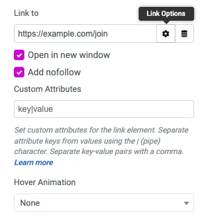

# Elementor widgets overview (Widgets overview)

**Also called:** Elementor widgets, page builder elements, hero banner, slider, pricing table, member grid, product slider, testimonial slider.

## What this does

Wbcom Essential adds 43 widgets to Elementor. A widget is a ready-made block of content that you drag onto a page, such as a slider, a pricing table or a member grid. This page lists the three groups and says which one to open. You need Elementor 3.5 or higher. Set it up as described in [Set up the plugins Wbcom Essential works with](../intro/set-up-companion-plugins.md).

## Widget groups

| Group | Widgets | Needs | Details |
|-------|---------|-------|---------|
| General | 27 | Elementor only | [Design and content widgets](general-widgets.md) |
| BuddyPress | 11 | BuddyPress or BuddyBoss Platform. bbPress for the two forum widgets. | [Community widgets](buddypress-widgets.md) |
| WooCommerce | 5 | WooCommerce | [Shop widgets](woocommerce-widgets.md) |

## Steps

1. Open a page with **Edit with Elementor**.
2. In the Elementor panel, scroll to the **Wbcom Essential** category. Or type the widget name in the search box.
3. Drag the widget onto the page.
4. Use the **Content** tab to set what it shows, and the **Style** tab to set how it looks. Many widgets have device icons, so you can set values for desktop, tablet and mobile.

## You'll know it worked when

The widget shows on the page in the Elementor editor. After you click **Update**, it shows on the live page.

## Good to know

### Why can't I see a widget in the panel?

A widget appears only when the plugin it needs is active. For example, the WooCommerce widgets stay hidden until you activate WooCommerce.

Header Notification Area appears only when the Reign theme is active. Every other widget works on any theme.

### Why do the widget colours match my theme?

On Reign, BuddyX and BuddyX Pro, colours you have not changed follow the theme's colours in light and dark mode. When you pick a colour in a widget, your colour is used. On other themes the widgets keep their own built-in colours. See [Theme colours](../features/theme-colors.md).

### How do links work in widgets?

Widgets with a link field use Elementor's link options: the URL, **Open in new window**, **Add nofollow** and custom attributes. These apply in Shape, Portfolio Grid, Team Carousel, Dropdown Button, Flip Box and Site Logo. A plain link in Site Logo opens in the same tab and has no nofollow.

### Why does a widget show nothing on the page?

Add Banner, Dropdown Button, Slider, Team Carousel and Portfolio Grid show nothing to visitors until you fill in their content, and Smart Menu prints nothing when its menu is empty. Wbcom Essential no longer publishes placeholder text or images. In the Elementor editor, Smart Menu tells you to choose a menu that has items.

### Will many widgets slow down my pages?

No. A widget's stylesheet loads only on pages that use that widget. A page without the Header Bar, the WooCommerce widgets or Forums Activity loads none of their styles.

## Related

- [Blocks overview](../blocks/blocks-overview.md) for the same plugin in the block editor
- [Responsive design](../features/responsive-design.md)
- [Performance](../features/performance.md)
- [Which block or widget to use](../features/solution-finder.md)
